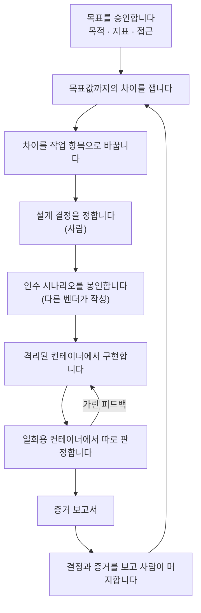

<h1 align="center">oh-my-factory</h1>

<p align="center">
  <strong>Claude Code 와 Codex CLI 를 위한, 목표 중심 소프트웨어 팩토리.</strong><br>
  사람은 목표와 결정과 증거를 승인합니다. 일은 에이전트가 봉인되고 격리된 루프 안에서 합니다.
</p>

<p align="center">
  <a href="LICENSE"></a>
  <a href="https://nodejs.org">= 22.12" src="https://img.shields.io/badge/node-%3E%3D22.12-brightgreen"></a>
  <a href="#지금-되는-것"></a>
</p>

<p align="center">
  <a href="#빠른-시작">빠른 시작</a> ·
  <a href="#어떻게-동작하나">어떻게 동작하나</a> ·
  <a href="#지금-되는-것">지금 되는 것</a> ·
  <a href="docs/ko/design/2026-10-12-omf-v0-design.md">설계</a> ·
  <a href="README.md">English</a>
</p>

> [!WARNING]
> **프리알파 단계입니다.** 지금은 기초(호스트 상태, 변조를 알아채는 원장, 초기화되지 않는 예산),
> 목표를 정의하고 승인하고 측정하는 부분(J1 잠금, 목표값까지의 차이, 관리 한계), J8 예산 명령,
> 작업 항목 저장소와 `work`, `veto` 명령, 그리고 목표 루프가 들어 있습니다. `omf goal tick` 은
> 모델이 숫자를 보지 못하게 한 채 격차를 작업 항목으로 바꿉니다.
> 검증 라인은 오프라인 시험이 붙은 라이브러리 코드로만 있습니다: 봉인된 시나리오와 GATE-2,
> 구현자 컨테이너, 판정·감사·test 분할 스테이션(S4~S6), GATE-3. 라인을 돌리는 명령(`omf run`,
> 그리고 `omf seal`, `omf report`)과 실제 모델을 쓰는 게이트 실행은 아직 만들지 않았습니다.
> 컨테이너 게이트 실행은 `docker inspect` 파서, 작업 사본, 컨테이너 두 개 왕복, 실제 격리 탐침에 대해
> 기록되어 있고, 구현자 컨테이너와 모델을 부르는 시험은 기록된 것이 없습니다.
> [지금 되는 것](#지금-되는-것)을 보세요.

---

## 왜 필요한가

코딩 에이전트는 작업을 끝내는 데 능숙합니다. 하지만 작업을 끝내는 것과 목표에 닿는 것은
다릅니다. 그 사이를 막는 것이 세 가지 있습니다.

- **에이전트가 자기 숙제를 자기가 채점합니다.** 코드 옆에 있는 테스트는 코드에 맞춰 고쳐 쓸 수
  있습니다. 구현자가 한 번도 보지 못한 시나리오는 그럴 수 없습니다.
- **에이전트가 목표를 놓칩니다.** 측정이 없으면 에이전트는 지금 하는 일이 숫자를 움직이는지,
  빠진 작업이 있는지 알 수 없습니다.
- **사람이 엉뚱한 것을 검토합니다.** 모든 줄을 읽는 것은 감당이 안 되고, 그냥 승인만 누르는 것은
  더 나쁩니다. 사람의 판단은 중요한 자리로 옮겨 가야 합니다. 목표, 설계 결정, 그리고 증거입니다.

oh-my-factory(OMF)는 이 루프를 돌리는 하네스입니다. 기본 `claude` 와 `codex` CLI 를 움직일 뿐,
그것들을 대신하지 않습니다.

## 어떻게 동작하나



OMF 는 루프 두 개를 돌립니다.

- **목표 루프**는 팩토리가 결과를 향하게 붙잡아 둡니다. 목표를 점검하고, 현재 값을 재고, 목표값과
  관리 범위(control band)에 견주고, 열린 작업을 정리한 뒤 새 작업을 내보냅니다. 출시 뒤에는 낮은
  빈도로 계속 지켜보다가 숫자가 다시 나빠지면 목표를 다시 엽니다.
- **검증 라인**은 작업 항목 하나를 맡습니다. 사람이 설계 결정을 정합니다. 다른 벤더가 인수
  시나리오를 쓰고, 그 시나리오는 구현자에게서 봉인됩니다. 구현자는 devcontainer 안에서 일합니다.
  믿을 수 있는 하네스가 별도의 일회용 컨테이너에서 결과를 판정하고, 구현자에게는 가린 피드백만
  돌려줍니다. 라인의 끝은 증거 보고서입니다.

## 사람이 정하는 것

| 사람이 정하는 것 | 언제 |
|---|---|
| 목표: 목적, 지표, 목표값, 가드레일 | 어떤 작업보다 먼저 |
| 설계 결정과 인터페이스 계약 | 구현 전에 |
| 어떤 신호를 믿을지, 어떤 경로가 고위험인지 | 처음에, 그리고 바뀔 때 |
| 격리 수준, 보안 설정, 예산 | 처음에, 그리고 예외가 생길 때 |
| 머지 | 증거 보고서를 본 뒤 |
| 목표 달성 확인 | 목표값에 닿았을 때, 비동기로 |
| 멈춤이나 예산 소진에 대한 대응 | 그 일이 생겼을 때, 비동기로 |

재시도, 결정론적 검사, 상태 전환, 기록 관리는 팩토리의 몫입니다. 위험도는 변경 내용과 경로로
계산하며, 에이전트가 고르지 않습니다.

## 설계 원칙

각 원칙에는 둘 중 하나의 표시가 붙어 있습니다. **지금 지켜짐**은
[`tests/enforcement`](tests/enforcement/README.md) 의 시험으로 확인한다는 뜻이고, **설계됨**은
아직 만들지 않았다는 뜻입니다.

- **사용자 설정은 읽기만 합니다.** *지금 지켜짐.* OMF 는 저장소, `AGENTS.md`, `CLAUDE.md`,
  `~/.claude`, `~/.codex` 를 읽기만 하고, 자기 상태 폴더에만 씁니다.
- **원장은 변조를 알아챕니다.** *지금 지켜짐.* 모든 명령은 먼저 해시 체인을 확인하고, 깨져 있으면
  멈춥니다.
- **예산은 초기화되지 않습니다.** *지금 지켜짐.* 다시 시작해도 예산이 차오르지 않고, 늘리는 것은
  사람만 할 수 있습니다.
- **지표 코드는 조용히 바뀌지 않습니다.** *지금 지켜짐.* 지표는 승인한 뒤에만 측정하고, 잠금을 고치면
  측정이 멈추며, 지표의 명령이나 `--watch` 로 지정한 경로, 관리 한계 파일, 또는 목표가 바뀌면 새 승인이 필요합니다.
  한계는 "목표를 정하고 재기" 절에 적혀 있습니다.
- **모델은 숫자를 보지 못합니다.** *지금 지켜짐, 목표 루프 쪽.* 작업을 제안하는 모델은 격차의 방향과 대략적인
  크기 구간만 받고, 값, 임계값, 지표 이름, 명령은 받지 못합니다. 모델의 답은 데이터로만 읽고, 작업 항목이
  되기 전에 코드가 걸러 냅니다. 봉인 시나리오 쪽은 설계됨.
- **작업보다 목표.** *일부 구현됨.* 작업은 측정값과 목표값의 차이에서 나옵니다. 목표, 잠금, 측정, 목표 루프는 지금 되고, 작업 항목을 실제로 수행하는 검증 라인이 다음입니다.
- **숙제가 아니라 홀드아웃.** *설계됨.* 인수 시나리오는 봉인되고, 다른 벤더가 쓰며, 구현자에게
  보이지 않습니다.
- **격리는 선언이 아니라 측정.** *일부 구현됨.* 판정기는 후보를 SUT 와 하네스 두 일회용 컨테이너(네트워크 없음,
  `docker.sock` 없음, 마운트된 경로 없음; 하네스만 시나리오를 stdin 으로 받아
  들고 있고 SUT 는 기대값을 보지 못합니다)에서 돌리고, 후보 코드가 돌기 전에 컨테이너마다 `docker inspect` 로 측정합니다. GATE-3 는 그 측정을 원장에서 읽습니다. 지금 시험되는 것은 가짜 Docker 를 쓴 오프라인 형태뿐입니다.
  실제 컨테이너 실행은 `docs/evidence/gated-runs.json` 에 기록된 것(실제 격리 탐침, 컨테이너 두 개 왕복) 밖에서는 강제되지 않으며,
  구현자 컨테이너는 아직 어떤 명령도 돌리지 않는 라이브러리 코드로만 있고([`docs/implementer.md`](docs/implementer.md)) 작성자 컨테이너는 없어서 실제 라인은 GATE-3 에서 `isolation_unmeasured` 로 멈춥니다
  ([`docs/container-judge.md`](docs/container-judge.md)).
- **비어 있으면 실패.** *일부 구현됨.* 라인 뼈대 (`E7a`), GATE-2 (`E7b`), 게이트 줄·감사·GATE-3 (`E7c`) 는
  없는 측정을 통과가 아니라 실패로 읽습니다. 심판의 판정(`E7d`)도 같습니다. 판정이 없거나 형식이 틀리거나 다른 라운드의 것이면 라운드가 끝나며 통과로 읽지 않습니다.
- **자동 머지도 자동 배포도 없음.** *설계됨.* 후보는 사람이 내보낼 때까지 로컬 `omf/*` 브랜치에
  머뭅니다.

## 지금 되는 것

| 명령 | 하는 일 |
|---|---|
| `omf init` | 현재 저장소의 호스트 상태를 `~/.omf` 아래에 만듭니다. 저장소와 에이전트 CLI 설정에는 아무것도 쓰지 않습니다. |
| `omf doctor [--json] [--strict]` | git, Docker, Claude Code, Codex, 저장소, 원장을 점검하고 `preflight.json` 을 씁니다. 에이전트 CLI 는 쓰고 버리는 임시 홈에서 실행합니다. Docker 가 없거나 실행 중이 아니거나 에이전트 CLI 가 없으면 필요한 단계를 밝힌 경고로 보고하고, 문제와 경고마다 한 줄 조치(`fix`)가 붙습니다. `--strict` 는 도구 누락 경고를 문제로 봅니다(원장 꼬리 손상은 경고로 남습니다). 설정의 `[judge]` 에 이미지와 Docker 컨텍스트가 있으면 격리 수준을 쓰고 버리는 컨테이너로 참고용 점검하고, 없으면 이유와 함께 `unmeasurable` 로 보고합니다. JSON 보고서에는 참고용 `implementer` 항목도 있어, 구현자 이미지가 설정됐는지와 `OMF_IMPLEMENTER_API_KEY` 설정 여부를 이름만으로 알려 줍니다(값은 절대 싣지 않습니다). |
| `omf ledger verify [--json]` | 원장의 해시 체인을 확인합니다. 원장이 손상됐으면 stderr 둘째 줄에 경로, 줄 번호, 다음 행동이 나오고 `--json` 은 같은 내용을 필드로 냅니다. `--json` 의 오류는 모두 `{ "ok": false, "error": { "code": "...", "message": "..." } }` 형태입니다(code: `not_initialized`, `ledger_corrupt`, `not_a_git_repository`, `git_not_found`, `unsupported_repository`, `symlink_refused`, `cannot_run`). 키는 snake_case 입니다. `omf init` 전에는 종료 코드 2 입니다. |
| `omf goal new <id>` | 템플릿으로 호스트 상태에 `goal.md` 를 만듭니다. |
| `omf metric propose <id> --unit <u> -- <command>` | 지표를 제안합니다. 값을 출력하는 명령, 단위, 바뀌면 체제 변경(regime change)이 되는 경로를 적습니다. |
| `omf goal audit <id>` | 목표, 잠금, 원장을 점검하고 체제 변경을 알려 줍니다. 아무것도 쓰지 않습니다. |
| `omf goal approve <id>` | J1: 잠글 내용(지표와 그 관리 한계)을 보여 주고, 터미널에서 목표 id 를 직접 입력하면 승인합니다. |
| `omf goal measure <id>` | 잠긴 지표를 실행하고(Docker, 또는 `--runner host` 로 호스트에서), 목표값까지의 차이와 관리 한계(control band)를 계산해 격차 보고서를 호스트 상태에 씁니다. |
| `omf goal tick <id>` | 목표 루프를 한 바퀴 돕니다(명세 §4.4). 점검, 측정, 모델에게 작업 요청, 후보를 코드로 걸러 내기, 작업 항목 내보내기, 낡음과 루프 보호 장치 확인. 조정 모델이 필요합니다("목표 루프 돌리기" 참고). |
| `omf goal status <id>` | 실행 상태(`running`, `blocked_on_user`, `failed`, `finish`, `cancelled`), 열린 에스컬레이션과 풀 수 있는 명령, 남은 라운드, 열린 작업 항목을 보여 줍니다. |
| `omf goal resume <id>` | J6 계속: 멈추게 한 원인을 고친 뒤, 터미널에서 확인을 입력하면 틱이 다시 돕니다. |
| `omf goal cancel <id>` | J6 중지: 터미널에서 확인을 입력하면 목표와 열린 작업 항목을 모두 취소합니다. |
| `omf budget show <id> [--json]` | 라운드, 공개, 벽시계 시간 예산의 선언값, 상향값, 사용량, 남은 양을 출력합니다. |
| `omf budget declare <id> <kind> <amount>` | J8: `rounds` 또는 `disclosure` 예산을 선언합니다. 대화형 터미널이 필요합니다. |
| `omf budget raise <id> <kind> <amount>` | J8: `rounds`, `disclosure`, `wall_time` 상한을 올립니다. 대화형 터미널이 필요하고, 벽시계 시간은 올리기만 되고 선언은 안 됩니다. |
| `omf budget raise <work_id> --rounds <n>` 또는 `--usd <amount>` | J8: 작업 항목 하나의 라운드 한도 또는 모델 비용 한도를 올립니다. 대화형 터미널이 필요합니다. 한도는 항목의 첫 실행이 시작될 때 `config.toml` 의 `[w]` 에서 복사됩니다. 항목의 상태는 바꾸지 않으니, 올린 뒤 항목을 다시 실행하세요. 항목에서 라인이 한 번 실행된 뒤(`omf run`, M3h)에야 쓸 수 있고, 그 전에는 기록된 한도가 없다며 종료 코드 2 로 거절합니다. |
| `omf work list <goal-id> [--state <s>] [--json]` | 목표의 작업 항목을 나열합니다. 원장에 기록이 없는 항목은 손상으로 보고합니다(종료 코드 1). |
| `omf work show <work-id>` | 작업 항목의 `item.md`, 클레임, `intent.md` 를 출력합니다. |
| `omf work approve <work-id>` | 위험도가 높은 작업 항목을 승인해 디스패치할 수 있게 합니다. 대화형 터미널이 필요합니다. |
| `omf veto <work-id> [--reason <text>]` | 열려 있는 어느 상태에서든 작업 항목을 거부합니다. 거부는 제한만 하므로 터미널이 필요 없습니다. |
| `omf decide add <work-id> --file <entry.json>` | 작업 항목의 설계 질문(결정)을 원장에 기록하고 `spec.md` 를 다시 만듭니다. 항목이 `ready` 이고 실행이 클레임을 쥐고 있지 않을 때만 됩니다. |
| `omf decide resolve <work-id> <decision-id> --file <resolution.json> [--na]` | 사람으로서 결정을 닫습니다(선택, 근거, 기각한 안. 인터페이스 결정은 빌드·실행·게이트 명령도 담습니다). 대화형 터미널이 필요합니다. `--na` 는 해당 없음으로 닫습니다. |
| `omf decide defer <work-id> <decision-id> --file <deferral.json>` | 서명된 기본값과 만료일을 두고 결정을 미룹니다. 대화형 터미널이 필요합니다. |
| `omf decide lint <work-id> [--json] [--render]` | 결정을 검사하고 GATE-1 을 계산합니다. 종료 코드 0 정상, 1 문제, 3 사람을 기다림(J2, `needs-human.json` 도 기록). `--render` 는 `spec.md` 를 다시 씁니다. |
| `omf decide show <work-id> [--json]` | 상태별 결정, GATE-1 판정, `spec.md` 가 원장과 같은지 출력합니다. 아무것도 쓰지 않습니다. |

종료 코드: `0` 정상, `1` 확인이 필요함(문제 발견, 거절된 확인, 멈췄거나 승인을 기다리는 틱), `2` 명령을 실행할 수 없음, `3` 사람을 기다림(`omf decide lint`: 열린 설계 결정).

시나리오 보관소와 GATE-2 는 라이브러리 코드로만 있고 아직 명령은 없습니다. GATE-1 을 통과하면 작성 세션이 시나리오를 쓰고, OMF 가 도장을 찍어 저장소 밖 보관소(`vault/scenarios/<work-id>/<seal-id>/`)에 두며, GATE-2 는 비었거나, 한쪽 분할이 없거나, 아무것도 하지 않는 프로그램을 통과시키거나, 모순 카나리가 하나도 없거나(`canary_missing`), 닫힌 결정이 연결되지 않은 세트를 거부합니다. 지금 작성자는 호스트의 스텁 프로세스라서 작성 단계는 측정되지 않은 것으로 보고하고, 봉인은 강제되지 않습니다. [`docs/m3c-spec-deviations.md`](docs/m3c-spec-deviations.md) 를 보십시오.

판정 스테이션은 아직 명령 없이 라이브러리 코드로만 있습니다. S4 는 저장된 train 분할과 모순 카나리를 일회용 컨테이너 두 개에서 k 번 판정하고, S5 는 게이트와 prove-test 를 컨테이너 작업 사본에서 돌려 감사하며, S6 은 test 분할을 한 번만 씁니다. 모두 가짜 Docker 로 오프라인 시험되고, 실제 컨테이너 실행은 따로 두며 기록되기 전까지 강제되지 않습니다. [`docs/container-judge.md`](docs/container-judge.md) 를 보십시오.

아직 만들지 않은 것: 작성자 컨테이너, 라인을 돌리는 명령(`omf run`, 쓰게 될 구현자 컨테이너는 라이브러리 코드로만 있습니다: [`docs/implementer.md`](docs/implementer.md)), 증거 보고서, `omf ship`, 목표 달성 확인(`omf goal sign`), 실행 도중 사람에게 입력을 요청하는 흐름. 모두 [설계 문서](docs/ko/design/2026-10-12-omf-v0-design.md)에
적혀 있습니다.

## 빠른 시작

필요한 것: Node.js 22.12 이상과 git. `omf doctor` 는 Docker, Claude Code, Codex CLI 도 찾습니다.
이것들은 다음 단계에서 쓰입니다.

아직 npm 에 올리지 않았습니다. 소스에서 설치합니다.

```sh
git clone https://github.com/ahwlsqja/oh-my-factory.git
cd oh-my-factory
npm install
npm run build
npm link            # PATH 에 `omf` 를 올립니다
```

그다음 아무 git 저장소 안에서:

```console
$ omf init
initialized /Users/you/.omf/projects/5a1948fe53d2a09f

$ omf ledger verify
ok: 1 event, head e3796f5ab9e6ec69…

$ omf doctor
ok
warning: claude not found on PATH (needed for: the implementer, the sealing author)
  fix: install the claude CLI and make sure `claude` is on PATH
```

`omf doctor` 는 문제가 있을 때만 종료 코드 1 입니다(예: `project not initialized; run omf init`, 항목마다 `fix:` 줄이
붙습니다). 경고는 종료 코드를 바꾸지 않으므로 Docker 가 실행 중이 아니어도 종료 코드는 0 입니다. `omf doctor --strict` 는 도구 경고(Docker 없음, Docker 미실행, 에이전트 CLI 없음)를 문제로 셉니다. `omf doctor --json` 은
`problem_details` 와 `warning_details`(조치와 도구가 필요한 단계) 를 포함한 보고서 전체를 출력합니다.

## 목표를 정하고 재기

사람의 결정을 기록하는 명령(`omf metric propose`, `omf goal approve`, `omf goal resume`, `omf goal cancel`,
`omf work approve`, `omf work veto`, `omf budget declare`, `omf budget raise`, `omf decide resolve`, `omf decide defer`)은 당신을 `human:<email>` 로
기록합니다. 이메일은 저장소 안에서 `git config user.email` 이 돌려주는 값입니다. 먼저 설정해 두세요. 없으면
명령이 멈추고 그렇게 안내합니다. 이 식별자는 명령 출력(확인 입력 줄 포함)에 나오고, 프로젝트의 `ledger.jsonl`
과 `~/.omf`(또는 `OMF_HOME`) 아래 제안·잠금 파일, 작업 항목의 `item.md`(`approval` 필드)에 저장됩니다. 모두 당신의 기기 안입니다. OMF 는 이를 어디로도
보내지 않습니다. 텔레메트리도 없고 공개되는 것도 없습니다. 출력, ledger 일부, 보고서를 이슈나 채팅에 붙이기
전에는 주소를 가린 뒤 올리세요. 예를 들면 `human:you@example.com` 으로 바꿉니다. 비밀은 아니지만 개인정보입니다.
그 밖에 빼야 할 것은 [`SECURITY.md`](SECURITY.md)(영어)를 보세요.

```console
$ omf init
initialized ~/.omf/projects/3186047891f1f0a0

$ omf goal new g-demo
created ~/.omf/projects/3186047891f1f0a0/goals/g-demo/goal.md
edit it, propose its metrics with omf metric propose, then run omf goal audit g-demo

$ # goal.md 를 고칩니다: 목표 m-demo <= 5 ms, lagging: [m-demo]
$ omf metric propose m-demo --unit ms -- sh -c 'echo 7'
proposed m-demo as human:you@example.com

$ omf goal audit g-demo
goal g-demo: draft
ready for J1: run omf goal approve g-demo

$ omf goal approve g-demo
goal g-demo: Say what this goal is in a few words
objective: The outcome you want, in plain words
target: m-demo <= 5 ms
leading: none; lagging: m-demo; guardrails: none
budget: 10 rounds, 72h wall time, at most 2 open work items
decision rule: target met for 2 consecutive measurements and no guardrail breach (minimum observation 7d)
metric m-demo: ["sh","-c","echo 7"] -> ms; watches none
bands m-demo: none (not monitored)
Type g-demo to approve as human:you@example.com: g-demo
approved g-demo (regime 1)

$ omf goal measure g-demo --runner host
goal g-demo (regime 1), runner host
target m-demo: 7 ms; target <= 5 ms; gap 2 (decrease, medium)
  m-demo [target, lagging]: 7 ms
report: ~/.omf/projects/3186047891f1f0a0/goals/g-demo/reports/2026-10-12T06-27-24-995Z-gap.json
warning: measured on the host without isolation (--runner host)
```

재승인 화면은 먼저 왜 필요한지 보여 줍니다. 잠금 문제, 체제 변경, 바뀐 감시 경로의 diff 입니다. 읽는 동안
목표나 지표가 바뀌면 아무것도 승인되지 않습니다. 재승인은 예산을 바꾸지 않습니다. `goal.md` 의 라운드 수나
벽시계 시간이 이미 적용된 값과 다르면 `omf goal approve` 가 거부하고, 늘리는 것은 별도 결정(J8)입니다.

"지표 코드는 조용히 바뀌지 않습니다" 의 한계:

- 지표의 명령과 `--watch` 로 지정한 경로만 대상입니다. 지정하지 않으면 `omf metric propose` 가 경고합니다.
  지표가 읽지만 감시하지 않는 파일과 gitignore 된 입력은 새 승인 없이 바뀔 수 있습니다.
- 컨테이너 이미지 태그는 바뀔 수 있으므로 지표 이미지는 digest(`name@sha256:<64자리 16진수>`)로 고정해야 합니다.
  `omf metric propose --image` 는 태그를 거부하고, 태그가 든 제안이 저장된 목표를 승인할 때도 거부합니다. 이 규칙
  이전에 태그로 잠근 지표는 계속 측정되지만 `omf goal measure`, `omf goal tick` 을 `--runner docker`(기본값)로 실행할 때마다 경고가 나옵니다.
  digest 로 고정하려면 지표를 다시 제안하세요.
- `bands/<metric>.yaml` 은 목표와 함께 잠깁니다. 해시가 J1 승인에 들어가므로, 고치거나 새로 만들거나 지우면
  체제 변경입니다. 관리 한계가 잠기기 전에 승인한 목표는 다시 승인할 때까지 한계가 잠기지 않고, 승인 화면이
  그렇게 알려 줍니다.

## 목표 루프 돌리기

`omf goal tick <id>` 는 목표 루프를 한 번 도는 비대화형 명령이라서 cron, CI, 사람 누구나 실행할 수 있습니다.
틱은 목표를 점검하고, 잠긴 지표를 재고, 목표값과 관리 한계에 견줍니다. 움직일 이유가 있으면(목표에 못
미쳤거나 관리 한계가 `propose` 를 가리킬 때) 모델에게 작업 항목 후보를 묻고, 코드로 걸러서, 살아남은 것만
호스트 상태에 작업 항목으로 씁니다. 목표값을 충분히 오래 채웠고 모든 가드레일이 통과하면 달성 후보를 기록하고
목표가 끝납니다.

모델이 받는 것은 `goal.md` 의 목적과 `## Approach` 절, 격차의 방향과 크기 구간(`small`, `medium`, `large`),
열린 작업 항목, 결과 집계입니다. 값, 목표값, 임계값, 지표 이름이나 명령, 감시 경로는 받지 못합니다. 모델의
답은 데이터로만 읽습니다. 숫자 임계값이나 지표 이름이 들어 있거나, 이미 있는 항목(어떤 상태든)과 겹치거나,
동시 진행 상한을 넘거나, 저장소 밖을 가리키는 후보는 아무것도 쓰기 전에 버립니다.

오프라인으로 보려면 [`examples/hello-goal`](examples/hello-goal/README.md) 을 실행하세요. 모델 대역을 쓰는
목표 루프 두 바퀴가 돕니다. 이 예제의 설명은 영어입니다.

### 조정 모델 (reconciler)

모델은 `config.toml` 에서 정합니다. OMF 는 이 파일을 다시 쓰지 않습니다. 파일이 없으면 오류이고, `[reconciler]`
절만 없으면 아래 기본값이 적용됩니다.

```toml
[reconciler]
kind = "claude"          # 또는 "command": 프롬프트를 stdin 으로 읽고 JSON 을 출력하는 프로그램
# model = "..."
# timeout_ms = 120000
```

`kind = "claude"` 는 호스트에서 `claude` CLI 를 도구를 모두 끈 채, 세션을 저장하지 않고, 빈 임시 폴더를 작업
폴더로 삼아, 환경 변수는 `ANTHROPIC_API_KEY` 하나만 넘겨 실행합니다. 틱을 돌리기 전에 그 변수를 지정하세요.
키체인이나 로그인 파일 로그인은 쓰지 않습니다. `kind = "command"` 는 `command` 에 적은 argv 를 실행하며,
시험과 예제가 씁니다. `kind = "codex"` 와 `auth = "login_file"` 은 컨테이너 실행기가 생길 때까지 거부됩니다.

구현자 컨테이너는 일부러 다르게 다룹니다. 구현자가 컨테이너 안에서 쓰고 실행하는 코드는 받은 키를 읽을 수 있으므로,
그 키는 조정 모델용 `ANTHROPIC_API_KEY` 가 아닙니다. 사용 한도를 건 별도의 Anthropic 워크스페이스 키를 만들어,
구현자를 돌리는 명령 한 번에만 `OMF_IMPLEMENTER_API_KEY` 로 지정하세요. OMF 는 이 변수만 읽고
(`ANTHROPIC_API_KEY` 로 대신하지 않습니다) 컨테이너에는 Claude CLI 가 기대하는 이름으로 전달합니다. 키가 없으면
구현자 단계는 인프라 실패(`infra_failure`, 키를 지정하고 다시 돌리면 됩니다)로 막힙니다. 멈춤 자체에는 그 코드만 담기고, `omf doctor --json` 의 참고용 `implementer` 항목이 `OMF_IMPLEMENTER_API_KEY` 와 그 설정 여부를 알려 줍니다.

`claude` 종류는 실제 모델로 검증하지 않았습니다. `scripts/smoke-reconciler.sh` 가 수동 확인 수단입니다.

### 라운드, 종료 상태, 종료 코드

라운드는 모델을 부른 틱이 쓰는 것이고, 목표의 라운드는 그 틱만 소비합니다. 기다리는 틱(목표가 `observing`
또는 `idle` 이거나, 동시 진행 상한이 찼거나, 검토를 기다리는 항목이 너무 많을 때)은 아무것도 소비하지
않으며, 이런 틱은 벽시계 시간으로 제한합니다.

| 상태 | 언제 | 할 일 |
|---|---|---|
| `running` | 기본 | 없음 |
| `blocked_on_user` | 사람의 결정이 필요함: 재승인(J1), 멈춘 진행이나 되풀이되는 결과(J6), 소진된 라운드나 시간 예산(J8) | `omf goal status <id>` 가 정확한 명령을 알려 줍니다. 그다음 `omf goal resume <id>` |
| `failed` | 틱 안의 예상치 못한 오류 | 오류를 읽은 뒤 `omf goal resume <id>` |
| `finish` | 달성 후보(명세 §4.5)가 기록됨 | 달성 확인(J5)은 아직 만들지 않았습니다 |
| `cancelled` | `omf goal cancel <id>` | 최종 |

`omf goal tick` 은 틱이 이어지거나 목표가 끝나면 `0` 으로 끝납니다. 사람을 기다리며 멈추면(막힘, 실패,
`omf work approve <work-id>` 를 기다리는 항목) `1`, 실행 자체를 못 하면(다른 틱이 잠금을 쥐고 있음,
`config.toml` 이 없거나 잘못됨, 원장 손상) `2` 입니다. 출력에는 결과, 격차의 방향과 크기 구간, 작업 id, 서명
코드, 다음 단계만 나오고 측정값이나 목표값은 나오지 않습니다. 그 값은 호스트 상태의 보고서에만 있습니다.

### 작업 항목

내보낸 항목은 `goals/<id>/work/<work-id>/` 에 있습니다. 위험도는 후보가 선언한 경로로 코드가 계산합니다. CI,
인증, 마이그레이션, 시험, 락 파일, 목표와 팩토리 파일, 감시 경로는 고위험입니다. 고위험 항목은
`awaiting_approval` 에서 `omf work approve` 를 기다리고, 나머지는 `ready` 로 시작합니다. 열려 있는 항목은
언제든 `omf veto <work-id>` 로 거부할 수 있습니다. 항목의 승인, 거부, 취소 여부는 항목 파일이 아니라 원장이
정합니다. 승인된 것처럼 손으로 고친 `item.md` 는 `omf work list` 가 손상된 항목으로 알리고, 내보내지 않습니다.

목표 루프의 한계:

- 시드 린트는 숫자와 지표 이름을 잡을 뿐, 말 바꾸기는 잡지 못합니다. 임계값을 다른 말로 다시 쓰면 통과합니다.
- 중복 검사는 제목의 낱말과 선언한 경로를 비교합니다. 같은 변경을 제목만 바꿔 내면 새 항목입니다.
- 공개량 예산을 선언하지 않으면 모델을 부르는 횟수는 라운드로만 제한됩니다. 구현자에게 주는 가려진 피드백은 라이브러리 코드와 시험으로만 있고 아직 이를 부르는 명령이나 스테이션이 없습니다. 라인에 연결되면 `disclosure` 예산을 선언하기 전에는 한 번도 나가지 않습니다.
- 선언한 `disclosure` 예산은 목표당 하나입니다. 지금은 목표 재시드가 이 예산을 쓰고, 가려진 피드백 공개도 라인에 연결되면 같은 예산을 나눠 쓰므로 어느 쪽이든 다 쓰면 다른 쪽이 막힙니다. 늘리는 것은 사람만 합니다(`omf budget raise <id> disclosure <amount>`).
- 조정 모델에는 아직 구독이나 키체인 로그인을 쓸 수 없습니다. API 키를 쓰세요.
- 재승인하면 벽시계 시간 한도가 `goal.md` 의 값으로 돌아갑니다. 그 전에 `omf budget raise <id> wall_time` 으로 늘린 만큼은 이어지지 않고 승인 화면에도 나오지 않습니다. 낡은(stale) 목표를 다시 승인한 뒤에도 계속 돌려야 하면 다시 늘리세요.

## 상태가 저장되는 곳

OMF 는 모든 것을 저장소 밖에, 프로젝트마다 폴더 하나로 둡니다.

```
~/.omf/projects/<project-id>/
  ledger.jsonl            추가만 되는, 해시 체인으로 묶인 이벤트 기록
  config.toml             역할, 격리 수준, 선택 사항인 [reconciler]
  preflight.json          마지막 점검 보고서
  goals/<goal-id>/
    goal.md               목표: 목적, 목표값, 예산
    bands/<metric>.yaml   관리 한계 (목표와 함께 잠김)
    reports/              격차 보고서(<stamp>-gap.json)와 틱 보고서(<stamp>-tick.md)
    reconcile/            틱마다 모델에 준 입력과 받은 원본 출력
    work/<work-id>/       item.md (상태, 진행, 승인자가 담긴 승인)와 intent.md
    tick.lock             틱이 도는 동안 쥐는 잠금
  vault/
    metrics/proposed/     지표 제안, <metric>.json
    metrics/<goal-id>/    J1 잠금: <metric>.lock.json, goal.lock.json
    scenarios/            봉인 시나리오 (M3 전까지 비어 있음)
  runs/  worktrees/       다음 단계용
```

다른 위치를 쓰려면 `OMF_HOME` 을 지정하세요. OMF 는 상태를 저장소 안이나 `~/.claude`, `~/.codex`
안에 두는 것을 거부합니다. 폴더 권한은 `0700`, 파일 권한은 `0600` 입니다.

ledger, 지표 제안, J1 잠금 파일에도 제안하거나 승인한 사람의 `human:<email>` 이 들어 있습니다("목표를 정하고 재기" 참고). 공유하기 전에 가리세요.

보고서와 `reconcile/` 파일에는 실제 측정값이 들어 있습니다. 호스트 상태 안에만 있고, 모델은 읽지 못합니다.

지우려면 `npm unlink -g oh-my-factory` 를 실행하고 `~/.omf` 를 삭제하세요.

## 문서

- [설계 명세](docs/ko/design/2026-10-12-omf-v0-design.md) ([English](docs/design/2026-10-12-omf-v0-design.md))
- [출처와 읽은 상태](docs/design/references.md)
- [강제 시험과 그 시험이 확인하는 주장](tests/enforcement/README.md)
- [목표 루프의 결정과 열린 질문 (M2b 부록, 영어)](docs/design/2026-10-12-omf-m2b-addendum.md)
- [`examples/hello-goal`](examples/hello-goal/README.md): 목표 루프를 오프라인으로 끝까지 돌려 보는 예제 (영어)

## 영감을 받은 곳

설계는 Will Larson 의 소프트웨어 팩토리 실험, StrongDM 의 Software Factory, Anthropic 의 AI-native
SDLC 플레이북, 그리고 사람의 판단이 어디에 있어야 하는지에 대한 Addy Osmani 와 Piotr Sarnacki 의
글 위에 서 있습니다. 도구 계층은 oh-my-claudecode, oh-my-codex, addyosmani/factory, Kilroy, OpenAI
의 Symphony 명세를 참고했습니다. 설계를 가져다 쓴 곳(선점 잠금의 낡음 판정은 Kilroy 의 설계를 따름)도 코드는 독립 구현이며,
무엇을 어디서 가져왔는지는 [`docs/third-party.md`](docs/third-party.md) 에 적혀 있습니다. 모든 출처는
[`docs/design/references.md`](docs/design/references.md) 에 있습니다.

## 기여하기

OMF 는 프리알파라서, 지금은 이슈와 설계 논의가 가장 도움이 됩니다.

```sh
npm install
npm run typecheck   # 소스와 시험
npm test            # dist/ 를 빌드하고 시험을 돌립니다
```

`sh scripts/smoke-reconciler.sh` 는 실제 `claude` CLI 를 무해한 프롬프트로 한 번 실행하고 답이 해석되는지
확인합니다. API 토큰을 쓰고 `ANTHROPIC_API_KEY` 가 필요하므로 `npm test` 에는 들어 있지 않습니다.

커밋 메시지는 [Conventional Commits](https://www.conventionalcommits.org/) 를 따릅니다.

## 라이선스

[Apache-2.0](LICENSE)
