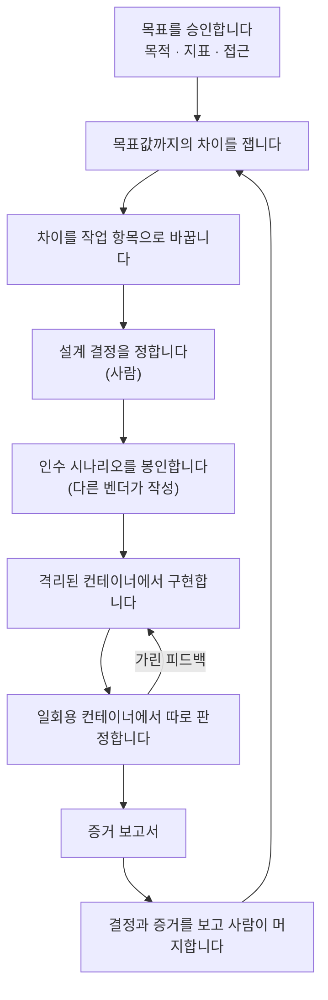

<h1 align="center">oh-my-factory</h1>

<p align="center">
  <strong>Claude Code 와 Codex CLI 를 위한, 목표 중심 소프트웨어 팩토리.</strong><br>
  사람은 목표와 결정과 증거를 승인합니다. 일은 에이전트가 봉인되고 격리된 루프 안에서 합니다.
</p>

<p align="center">
  <a href="LICENSE"></a>
  <a href="https://nodejs.org">= 22.12" src="https://img.shields.io/badge/node-%3E%3D22.12-brightgreen"></a>
  <a href="#지금-되는-것"></a>
</p>

<p align="center">
  <a href="#빠른-시작">빠른 시작</a> ·
  <a href="#어떻게-동작하나">어떻게 동작하나</a> ·
  <a href="#지금-되는-것">지금 되는 것</a> ·
  <a href="docs/ko/design/2026-10-12-omf-v0-design.md">설계</a> ·
  <a href="README.md">English</a>
</p>

> [!WARNING]
> **프리알파 단계입니다.** 지금은 기초(호스트 상태, 변조를 알아채는 원장, 초기화되지 않는 예산)와
> 목표를 정의하고 승인하고 측정하는 부분(J1 잠금, 목표값까지의 차이, 관리 한계)이 들어 있습니다.
> 격차를 일로 바꾸는 부분(`omf goal tick`)과 검증 라인은 설계만 끝났고 아직 만들지 않았습니다.
> [지금 되는 것](#지금-되는-것)을 보세요.

---

## 왜 필요한가

코딩 에이전트는 작업을 끝내는 데 능숙합니다. 하지만 작업을 끝내는 것과 목표에 닿는 것은
다릅니다. 그 사이를 막는 것이 세 가지 있습니다.

- **에이전트가 자기 숙제를 자기가 채점합니다.** 코드 옆에 있는 테스트는 코드에 맞춰 고쳐 쓸 수
  있습니다. 구현자가 한 번도 보지 못한 시나리오는 그럴 수 없습니다.
- **에이전트가 목표를 놓칩니다.** 측정이 없으면 에이전트는 지금 하는 일이 숫자를 움직이는지,
  빠진 작업이 있는지 알 수 없습니다.
- **사람이 엉뚱한 것을 검토합니다.** 모든 줄을 읽는 것은 감당이 안 되고, 그냥 승인만 누르는 것은
  더 나쁩니다. 사람의 판단은 중요한 자리로 옮겨 가야 합니다. 목표, 설계 결정, 그리고 증거입니다.

oh-my-factory(OMF)는 이 루프를 돌리는 하네스입니다. 기본 `claude` 와 `codex` CLI 를 움직일 뿐,
그것들을 대신하지 않습니다.

## 어떻게 동작하나



OMF 는 루프 두 개를 돌립니다.

- **목표 루프**는 팩토리가 결과를 향하게 붙잡아 둡니다. 목표를 점검하고, 현재 값을 재고, 목표값과
  관리 범위(control band)에 견주고, 열린 작업을 정리한 뒤 새 작업을 내보냅니다. 출시 뒤에는 낮은
  빈도로 계속 지켜보다가 숫자가 다시 나빠지면 목표를 다시 엽니다.
- **검증 라인**은 작업 항목 하나를 맡습니다. 사람이 설계 결정을 정합니다. 다른 벤더가 인수
  시나리오를 쓰고, 그 시나리오는 구현자에게서 봉인됩니다. 구현자는 devcontainer 안에서 일합니다.
  믿을 수 있는 하네스가 별도의 일회용 컨테이너에서 결과를 판정하고, 구현자에게는 가린 피드백만
  돌려줍니다. 라인의 끝은 증거 보고서입니다.

## 사람이 정하는 것

| 사람이 정하는 것 | 언제 |
|---|---|
| 목표: 목적, 지표, 목표값, 가드레일 | 어떤 작업보다 먼저 |
| 설계 결정과 인터페이스 계약 | 구현 전에 |
| 어떤 신호를 믿을지, 어떤 경로가 고위험인지 | 처음에, 그리고 바뀔 때 |
| 격리 수준, 보안 설정, 예산 | 처음에, 그리고 예외가 생길 때 |
| 머지 | 증거 보고서를 본 뒤 |
| 목표 달성 확인 | 목표값에 닿았을 때, 비동기로 |
| 멈춤이나 예산 소진에 대한 대응 | 그 일이 생겼을 때, 비동기로 |

재시도, 결정론적 검사, 상태 전환, 기록 관리는 팩토리의 몫입니다. 위험도는 변경 내용과 경로로
계산하며, 에이전트가 고르지 않습니다.

## 설계 원칙

각 원칙에는 둘 중 하나의 표시가 붙어 있습니다. **지금 지켜짐**은
[`tests/enforcement`](tests/enforcement/README.md) 의 시험으로 확인한다는 뜻이고, **설계됨**은
아직 만들지 않았다는 뜻입니다.

- **사용자 설정은 읽기만 합니다.** *지금 지켜짐.* OMF 는 저장소, `AGENTS.md`, `CLAUDE.md`,
  `~/.claude`, `~/.codex` 를 읽기만 하고, 자기 상태 폴더에만 씁니다.
- **원장은 변조를 알아챕니다.** *지금 지켜짐.* 모든 명령은 먼저 해시 체인을 확인하고, 깨져 있으면
  멈춥니다.
- **예산은 초기화되지 않습니다.** *지금 지켜짐.* 다시 시작해도 예산이 차오르지 않고, 늘리는 것은
  사람만 할 수 있습니다.
- **지표 코드는 조용히 바뀌지 않습니다.** *지금 지켜짐.* 지표는 승인한 뒤에만 측정하고, 잠금을 고치면
  측정이 멈추며, 지표의 명령이나 `--watch` 로 지정한 경로, 또는 목표가 바뀌면 새 승인이 필요합니다.
  한계는 "목표를 정하고 재기" 절에 적혀 있습니다.
- **작업보다 목표.** *일부 구현됨.* 작업은 측정값과 목표값의 차이에서 나옵니다. 목표, 잠금, 측정은 지금 되고, 격차를 일로 바꾸는 부분이 다음입니다.
- **숙제가 아니라 홀드아웃.** *설계됨.* 인수 시나리오는 봉인되고, 다른 벤더가 쓰며, 구현자에게
  보이지 않습니다.
- **격리는 선언이 아니라 측정.** *설계됨.* `omf doctor` 가 실제로 걸린 격리를 재고, 선언보다
  약하면 실행이 실패합니다.
- **비어 있으면 실패.** *설계됨.* 증거가 없으면 게이트를 통과하지 못합니다. 없는 것을 통과로 읽지
  않습니다.
- **자동 머지도 자동 배포도 없음.** *설계됨.* 후보는 사람이 내보낼 때까지 로컬 `omf/*` 브랜치에
  머뭅니다.

## 지금 되는 것

| 명령 | 하는 일 |
|---|---|
| `omf init` | 현재 저장소의 호스트 상태를 `~/.omf` 아래에 만듭니다. 저장소와 에이전트 CLI 설정에는 아무것도 쓰지 않습니다. |
| `omf doctor` | git, Docker, Claude Code, Codex, 저장소, 원장을 점검하고 `preflight.json` 을 씁니다. 에이전트 CLI 는 쓰고 버리는 임시 홈에서 실행합니다. |
| `omf ledger verify` | 원장의 해시 체인을 확인합니다. |
| `omf goal new <id>` | 템플릿으로 호스트 상태에 `goal.md` 를 만듭니다. |
| `omf metric propose <id> --unit <u> -- <command>` | 지표를 제안합니다. 값을 출력하는 명령, 단위, 바뀌면 체제 변경(regime change)이 되는 경로를 적습니다. |
| `omf goal audit <id>` | 목표, 잠금, 원장을 점검하고 체제 변경을 알려 줍니다. 아무것도 쓰지 않습니다. |
| `omf goal approve <id>` | J1: 잠글 내용을 보여 주고, 터미널에서 목표 id 를 직접 입력하면 승인합니다. |
| `omf goal measure <id>` | 잠긴 지표를 실행하고(Docker, 또는 `--runner host` 로 호스트에서), 목표값까지의 차이와 관리 한계(control band)를 계산해 격차 보고서를 호스트 상태에 씁니다. |

종료 코드: `0` 정상, `1` 문제 발견, `2` 명령을 실행할 수 없음.

아직 만들지 않은 것: 격차를 일로 바꾸는 부분(`omf goal tick`: 조정, 필터, 디스패치), 결정 원장과 봉인 시나리오, 컨테이너 실행기와 판정기, 증거 보고서, 사람에게 입력을 요청하는 흐름. 모두 [설계 문서](docs/ko/design/2026-10-12-omf-v0-design.md)에
적혀 있습니다.

## 빠른 시작

필요한 것: Node.js 22.12 이상과 git. `omf doctor` 는 Docker, Claude Code, Codex CLI 도 찾습니다.
이것들은 다음 단계에서 쓰입니다.

아직 npm 에 올리지 않았습니다. 소스에서 설치합니다.

```sh
git clone https://github.com/ahwlsqja/oh-my-factory.git
cd oh-my-factory
npm install
npm run build
npm link            # PATH 에 `omf` 를 올립니다
```

그다음 아무 git 저장소 안에서:

```console
$ omf init
initialized /Users/you/.omf/projects/5a1948fe53d2a09f

$ omf ledger verify
ok: 1 event, head e3796f5ab9e6ec69…

$ omf doctor
problems:
  - docker daemon is not reachable
```

`omf doctor --json` 은 보고서 전체를 출력합니다.

## 목표를 정하고 재기

```console
$ omf init
initialized ~/.omf/projects/3186047891f1f0a0

$ omf goal new g-demo
created ~/.omf/projects/3186047891f1f0a0/goals/g-demo/goal.md
edit it, propose its metrics with omf metric propose, then run omf goal audit g-demo

$ # goal.md 를 고칩니다: 목표 m-demo <= 5 ms, lagging: [m-demo]
$ omf metric propose m-demo --unit ms -- sh -c 'echo 7'
proposed m-demo as human:you@example.com

$ omf goal audit g-demo
goal g-demo: draft
ready for J1: run omf goal approve g-demo

$ omf goal approve g-demo
goal g-demo: Say what this goal is in a few words
objective: The outcome you want, in plain words
target: m-demo <= 5 ms
leading: none; lagging: m-demo; guardrails: none
budget: 10 rounds, 72h wall time, at most 2 open work items
decision rule: target met for 2 consecutive measurements and no guardrail breach (minimum observation 7d)
metric m-demo: ["sh","-c","echo 7"] -> ms; watches none
Type g-demo to approve as human:you@example.com: g-demo
approved g-demo (regime 1)

$ omf goal measure g-demo --runner host
goal g-demo (regime 1), runner host
target m-demo: 7 ms; target <= 5 ms; gap 2 (decrease, medium)
  m-demo [target, lagging]: 7 ms
report: ~/.omf/projects/3186047891f1f0a0/goals/g-demo/reports/2026-10-12T06-27-24-995Z-gap.json
warning: measured on the host without isolation (--runner host)
```

재승인 화면은 먼저 왜 필요한지 보여 줍니다. 잠금 문제, 체제 변경, 바뀐 감시 경로의 diff 입니다. 읽는 동안
목표나 지표가 바뀌면 아무것도 승인되지 않습니다. 재승인은 예산을 바꾸지 않습니다. `goal.md` 의 라운드 수나
벽시계 시간이 이미 적용된 값과 다르면 `omf goal approve` 가 거부하고, 늘리는 것은 별도 결정(J8)입니다.

"지표 코드는 조용히 바뀌지 않습니다" 의 한계:

- 지표의 명령과 `--watch` 로 지정한 경로만 대상입니다. 지정하지 않으면 `omf metric propose` 가 경고합니다.
  지표가 읽지만 감시하지 않는 파일과 gitignore 된 입력은 새 승인 없이 바뀔 수 있습니다.
- `bands.yaml` 은 아직 잠기지 않아서, 고치면 새 승인 없이 가드레일 판정이 바뀝니다.
- 컨테이너 이미지 태그는 바뀔 수 있습니다. 이미지를 고정하려면 digest 를 쓰세요.

## 상태가 저장되는 곳

OMF 는 모든 것을 저장소 밖에, 프로젝트마다 폴더 하나로 둡니다.

```
~/.omf/projects/<project-id>/
  ledger.jsonl            추가만 되는, 해시 체인으로 묶인 이벤트 기록
  config.toml             역할과 격리 수준
  preflight.json          마지막 점검 보고서
  goals/<goal-id>/
    goal.md               목표: 목적, 목표값, 예산
    bands/<metric>.yaml   관리 한계 (아직 잠기지 않음)
    reports/              격차 보고서, <stamp>-gap.json
  vault/
    metrics/proposed/     지표 제안, <metric>.json
    metrics/<goal-id>/    J1 잠금: <metric>.lock.json, goal.lock.json
    scenarios/            봉인 시나리오 (M3 전까지 비어 있음)
  runs/  worktrees/       다음 단계용
```

다른 위치를 쓰려면 `OMF_HOME` 을 지정하세요. OMF 는 상태를 저장소 안이나 `~/.claude`, `~/.codex`
안에 두는 것을 거부합니다. 폴더 권한은 `0700`, 파일 권한은 `0600` 입니다.

지우려면 `npm unlink -g oh-my-factory` 를 실행하고 `~/.omf` 를 삭제하세요.

## 문서

- [설계 명세](docs/ko/design/2026-10-12-omf-v0-design.md) ([English](docs/design/2026-10-12-omf-v0-design.md))
- [출처와 읽은 상태](docs/design/references.md)
- [강제 시험과 그 시험이 확인하는 주장](tests/enforcement/README.md)

## 영감을 받은 곳

설계는 Will Larson 의 소프트웨어 팩토리 실험, StrongDM 의 Software Factory, Anthropic 의 AI-native
SDLC 플레이북, 그리고 사람의 판단이 어디에 있어야 하는지에 대한 Addy Osmani 와 Piotr Sarnacki 의
글 위에 서 있습니다. 도구 계층은 oh-my-claudecode, oh-my-codex, addyosmani/factory, Kilroy, OpenAI
의 Symphony 명세를 따릅니다. 모든 출처는
[`docs/design/references.md`](docs/design/references.md) 에 있습니다.

## 기여하기

OMF 는 프리알파라서, 지금은 이슈와 설계 논의가 가장 도움이 됩니다.

```sh
npm install
npm run typecheck   # 소스와 시험
npm test            # dist/ 를 빌드하고 시험을 돌립니다
```

커밋 메시지는 [Conventional Commits](https://www.conventionalcommits.org/) 를 따릅니다.

## 라이선스

[Apache-2.0](LICENSE)
