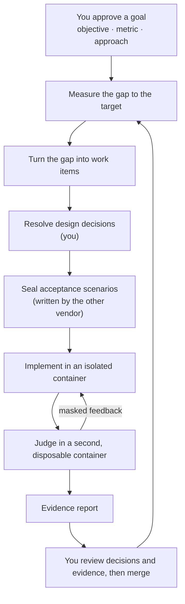

<h1 align="center">oh-my-factory</h1>

<p align="center">
  <strong>A goal-driven software factory for Claude Code and Codex CLI.</strong><br>
  You approve goals, decisions and evidence. Agents do the work inside a sealed, isolated loop.
</p>

<p align="center">
  <a href="LICENSE"></a>
  <a href="https://nodejs.org">= 22.12" src="https://img.shields.io/badge/node-%3E%3D22.12-brightgreen"></a>
  <a href="#what-works-today"></a>
</p>

<p align="center">
  <a href="#quick-start">Quick start</a> ·
  <a href="#how-it-works">How it works</a> ·
  <a href="#what-works-today">What works today</a> ·
  <a href="docs/design/2026-10-12-omf-v0-design.md">Design</a> ·
  <a href="README.ko.md">한국어</a>
</p>

> [!WARNING]
> **Pre-alpha.** Today oh-my-factory ships its foundation only: host state, a tamper-evident
> ledger, budgets that never reset, and three commands (`omf init`, `omf doctor`,
> `omf ledger verify`). The goal loop and the verification line described below are designed but
> not built yet. See [What works today](#what-works-today).

---

## Why

Coding agents are good at finishing tasks. Finishing tasks is not the same as reaching a goal, and
three things get in the way:

- **Agents grade their own homework.** A test that lives next to the code can be rewritten to match
  the code. A scenario the implementer never sees cannot.
- **Agents lose sight of the goal.** Without a measurement, an agent cannot tell whether the work is
  moving the number or whether a task is missing.
- **People review the wrong thing.** Reading every line does not scale, and rubber-stamping is
  worse. Human judgment should move to the places where it matters: the goal, the design
  decisions, and the evidence.

oh-my-factory (OMF) is a harness for that loop. It drives the stock `claude` and `codex` CLIs; it
does not replace them.

## How it works



OMF runs two loops:

- **The goal loop** keeps the factory pointed at an outcome. It audits the goal, measures the
  current value, compares it with the target and the control bands, reconciles open work, and
  dispatches new work. After launch it keeps watching at a lower frequency and reopens the goal if
  the number regresses.
- **The verification line** handles one work item. A person settles the design decisions. A
  different vendor writes acceptance scenarios that are sealed away from the implementer. The
  implementer works in a devcontainer. A trusted harness judges the result in a separate,
  disposable container and returns only masked feedback. The line ends with an evidence report.

## Where you stay in the loop

| You decide | When |
|---|---|
| The goal: objective, metric, target and guardrails | Before any work |
| Design decisions and interface contracts | Before implementation |
| Which signals to trust, and which paths are high-risk | Before, and when they change |
| Isolation level, security settings and budgets | Before, and on any exception |
| Merge | After the evidence report |
| Goal sign-off | Asynchronously, when the target is met |
| What to do about a stall or an exhausted budget | Asynchronously, when it happens |

Retries, deterministic checks, state transitions and bookkeeping are the factory's job. Risk is
computed from the diff and the paths, never chosen by an agent.

## Design principles

Each principle is either **enforced today** by a test in [`tests/enforcement`](tests/enforcement/README.md),
or **designed** and not built yet.

- **Your configuration is read-only to OMF.** *Enforced today.* OMF reads your repository,
  `AGENTS.md`, `CLAUDE.md`, `~/.claude` and `~/.codex`, and writes only to its own state directory.
- **The ledger is tamper-evident.** *Enforced today.* Every command checks the hash chain first and
  stops if it is broken.
- **Budgets never reset.** *Enforced today.* A restart does not refill a budget, and only a person
  can raise one.
- **Goals over tasks.** *Designed.* Work is derived from the gap between a measured value and a
  target.
- **Holdout, not homework.** *Designed.* Acceptance scenarios are sealed, written by the other
  vendor, and never shown to the implementer.
- **Isolation is measured, not declared.** *Designed.* `omf doctor` will measure the isolation in
  effect, and a run fails if it is weaker than declared.
- **Empty means fail.** *Designed.* Missing evidence fails a gate; it is never read as a pass.
- **No auto-merge, no auto-deploy.** *Designed.* Candidates live on local `omf/*` branches until a
  person ships them.

## What works today

| Command | What it does |
|---|---|
| `omf init` | Creates host state for the current repository under `~/.omf`. Writes nothing to the repository or to the agent CLIs' configuration. |
| `omf doctor` | Checks git, Docker, Claude Code and Codex, the repository and the ledger, and writes `preflight.json`. Runs the agent CLIs with a throwaway home. |
| `omf ledger verify` | Checks the ledger's hash chain. |

Exit codes: `0` ok, `1` problems found, `2` the command could not run.

Not built yet: the goal loop, the decision ledger and sealed scenarios, the container runner and
judge, evidence reports, and asking people for input. The
[design](docs/design/2026-10-12-omf-v0-design.md) describes all of them.

## Quick start

Requirements: Node.js 22.12 or later and git. `omf doctor` also looks for Docker, Claude Code and
Codex CLI, which later stages will need.

OMF is not on npm yet. Install it from source:

```sh
git clone https://github.com/ahwlsqja/oh-my-factory.git
cd oh-my-factory
npm install
npm run build
npm link            # puts `omf` on your PATH
```

Then, inside any git repository:

```console
$ omf init
initialized /Users/you/.omf/projects/5a1948fe53d2a09f

$ omf ledger verify
ok: 1 event, head e3796f5ab9e6ec69…

$ omf doctor
problems:
  - docker daemon is not reachable
```

`omf doctor --json` prints the full report.

## Where state lives

OMF keeps everything outside your repository, one directory per project:

```
~/.omf/projects/<project-id>/
  ledger.jsonl        append-only, hash-chained event log
  config.toml         roles and isolation level
  preflight.json      the last doctor report
  vault/              sealed material (empty for now)
  runs/  worktrees/   reserved for later stages
```

Set `OMF_HOME` to use another location. OMF refuses to keep state inside the repository or inside
`~/.claude` or `~/.codex`. Directories are `0700` and files `0600`.

To uninstall, run `npm unlink -g oh-my-factory` and delete `~/.omf`.

## Documentation

- [Design specification](docs/design/2026-10-12-omf-v0-design.md) ([한국어](docs/ko/design/2026-10-12-omf-v0-design.md))
- [Sources and reading status](docs/design/references.md)
- [Enforcement tests and the claims they cover](tests/enforcement/README.md)

## Inspiration

The design builds on Will Larson's software factory experiment, StrongDM's Software Factory,
Anthropic's AI-native SDLC playbook, and the writing of Addy Osmani and Piotr Sarnacki on where
human judgment belongs. The tool layer follows oh-my-claudecode, oh-my-codex, addyosmani/factory,
Kilroy and OpenAI's Symphony spec. [`docs/design/references.md`](docs/design/references.md) lists
every source.

## Contributing

OMF is pre-alpha, so issues and design discussion are the most useful contributions right now.

```sh
npm install
npm run typecheck   # source and tests
npm test            # builds dist/ and runs the suite
```

Commits follow [Conventional Commits](https://www.conventionalcommits.org/).

## License

[Apache-2.0](LICENSE)
