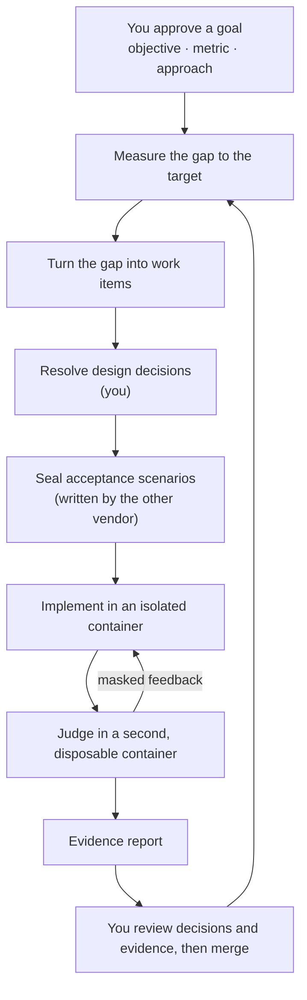

<h1 align="center">oh-my-factory</h1>

<p align="center">
  <strong>A goal-driven software factory for Claude Code and Codex CLI.</strong><br>
  You approve goals, decisions and evidence. Agents do the work inside a sealed, isolated loop.
</p>

<p align="center">
  <a href="LICENSE"></a>
  <a href="https://nodejs.org">= 22.12" src="https://img.shields.io/badge/node-%3E%3D22.12-brightgreen"></a>
  <a href="#what-works-today"></a>
</p>

<p align="center">
  <a href="#quick-start">Quick start</a> ·
  <a href="#how-it-works">How it works</a> ·
  <a href="#what-works-today">What works today</a> ·
  <a href="docs/design/2026-10-12-omf-v0-design.md">Design</a> ·
  <a href="README.ko.md">한국어</a>
</p>

> [!WARNING]
> **Pre-alpha.** Today oh-my-factory ships its foundation (host state, a tamper-evident ledger,
> budgets that never reset) plus defining, approving and measuring goals (J1 locks, the gap to
> the target and control bands), the J8 budget commands, and the work-item store with its
> `work` and `veto` commands. Turning the gap into work (`omf goal tick`) and the verification
> line are designed but not built yet. See [What works today](#what-works-today).

---

## Why

Coding agents are good at finishing tasks. Finishing tasks is not the same as reaching a goal, and
three things get in the way:

- **Agents grade their own homework.** A test that lives next to the code can be rewritten to match
  the code. A scenario the implementer never sees cannot.
- **Agents lose sight of the goal.** Without a measurement, an agent cannot tell whether the work is
  moving the number or whether a task is missing.
- **People review the wrong thing.** Reading every line does not scale, and rubber-stamping is
  worse. Human judgment should move to the places where it matters: the goal, the design
  decisions, and the evidence.

oh-my-factory (OMF) is a harness for that loop. It drives the stock `claude` and `codex` CLIs; it
does not replace them.

## How it works



OMF runs two loops:

- **The goal loop** keeps the factory pointed at an outcome. It audits the goal, measures the
  current value, compares it with the target and the control bands, reconciles open work, and
  dispatches new work. After launch it keeps watching at a lower frequency and reopens the goal if
  the number regresses.
- **The verification line** handles one work item. A person settles the design decisions. A
  different vendor writes acceptance scenarios that are sealed away from the implementer. The
  implementer works in a devcontainer. A trusted harness judges the result in a separate,
  disposable container and returns only masked feedback. The line ends with an evidence report.

## Where you stay in the loop

| You decide | When |
|---|---|
| The goal: objective, metric, target and guardrails | Before any work |
| Design decisions and interface contracts | Before implementation |
| Which signals to trust, and which paths are high-risk | Before, and when they change |
| Isolation level, security settings and budgets | Before, and on any exception |
| Merge | After the evidence report |
| Goal sign-off | Asynchronously, when the target is met |
| What to do about a stall or an exhausted budget | Asynchronously, when it happens |

Retries, deterministic checks, state transitions and bookkeeping are the factory's job. Risk is
computed from the diff and the paths, never chosen by an agent.

## Design principles

Each principle is either **enforced today** by a test in [`tests/enforcement`](tests/enforcement/README.md),
or **designed** and not built yet.

- **Your configuration is read-only to OMF.** *Enforced today.* OMF reads your repository,
  `AGENTS.md`, `CLAUDE.md`, `~/.claude` and `~/.codex`, and writes only to its own state directory.
- **The ledger is tamper-evident.** *Enforced today.* Every command checks the hash chain first and
  stops if it is broken.
- **Budgets never reset.** *Enforced today.* A restart does not refill a budget, and only a person
  can raise one.
- **Metric code cannot change quietly.** *Enforced today.* A metric is measured only after you approve it,
  an edited lock stops measurement, and a change to the metric's command, to a path it watches (`--watch`), to its
  bands file, or to the goal needs a new approval. Limits are listed under "Define and measure a goal".
- **Goals over tasks.** *Partly built.* Work is derived from the gap between a measured value and a
  target. Goals, locks and measurement work today; turning the gap into work is next.
- **Holdout, not homework.** *Designed.* Acceptance scenarios are sealed, written by the other
  vendor, and never shown to the implementer.
- **Isolation is measured, not declared.** *Designed.* `omf doctor` will measure the isolation in
  effect, and a run fails if it is weaker than declared.
- **Empty means fail.** *Designed.* Missing evidence fails a gate; it is never read as a pass.
- **No auto-merge, no auto-deploy.** *Designed.* Candidates live on local `omf/*` branches until a
  person ships them.

## What works today

| Command | What it does |
|---|---|
| `omf init` | Creates host state for the current repository under `~/.omf`. Writes nothing to the repository or to the agent CLIs' configuration. |
| `omf doctor` | Checks git, Docker, Claude Code and Codex, the repository and the ledger, and writes `preflight.json`. Runs the agent CLIs with a throwaway home. |
| `omf ledger verify` | Checks the ledger's hash chain. |
| `omf goal new <id>` | Creates `goal.md` in host state from a template. |
| `omf metric propose <id> --unit <u> -- <command>` | Proposes a metric: the command that prints its value, the unit, and the paths whose change is a regime change. |
| `omf goal audit <id>` | Checks the goal, its locks and the ledger, and reports regime changes. Writes nothing. |
| `omf goal approve <id>` | J1: shows what will be locked (metrics and their bands) and approves it after you type the goal id in a terminal. |
| `omf goal measure <id>` | Runs the locked metrics (in Docker, or on the host with `--runner host`), computes the gap to target and the control bands, and writes a gap report to host state. |

| `omf budget show <id> [--json]` | Prints the rounds, disclosure and wall-time budgets: declared, raised, consumed and remaining. |
| `omf budget declare <id> <kind> <amount>` | J8: declares a `rounds` or `disclosure` budget, in an interactive terminal. |
| `omf budget raise <id> <kind> <amount>` | J8: raises a `rounds`, `disclosure` or `wall_time` cap, in an interactive terminal. Wall time can only be raised, never declared. |
| `omf work list <goal-id> [--state <s>] [--json]` | Lists a goal's work items. Items the ledger does not account for are reported as malformed (exit 1). |
| `omf work show <work-id>` | Prints a work item's `item.md`, claim and `intent.md`. |
| `omf work approve <work-id>` | Approves a high-risk work item so it can be dispatched, in an interactive terminal. |
| `omf veto <work-id> [--reason <text>]` | Vetoes a work item from any open state. Needs no terminal, because a veto only restricts. |

Exit codes: `0` ok, `1` problems found, `2` the command could not run.

Not built yet: turning the gap into work (`omf goal tick`: reconcile, filters, dispatch), the decision ledger and sealed scenarios, the container runner and judge, evidence reports, and asking people for input. The
[design](docs/design/2026-10-12-omf-v0-design.md) describes all of them.

## Quick start

Requirements: Node.js 22.12 or later and git. `omf doctor` also looks for Docker, Claude Code and
Codex CLI, which later stages will need.

OMF is not on npm yet. Install it from source:

```sh
git clone https://github.com/ahwlsqja/oh-my-factory.git
cd oh-my-factory
npm install
npm run build
npm link            # puts `omf` on your PATH
```

Then, inside any git repository:

```console
$ omf init
initialized /Users/you/.omf/projects/5a1948fe53d2a09f

$ omf ledger verify
ok: 1 event, head e3796f5ab9e6ec69…

$ omf doctor
problems:
  - docker daemon is not reachable
```

`omf doctor --json` prints the full report.

## Define and measure a goal

```console
$ omf init
initialized ~/.omf/projects/3186047891f1f0a0

$ omf goal new g-demo
created ~/.omf/projects/3186047891f1f0a0/goals/g-demo/goal.md
edit it, propose its metrics with omf metric propose, then run omf goal audit g-demo

$ # edit goal.md: target m-demo <= 5 ms, lagging: [m-demo]
$ omf metric propose m-demo --unit ms -- sh -c 'echo 7'
proposed m-demo as human:you@example.com

$ omf goal audit g-demo
goal g-demo: draft
ready for J1: run omf goal approve g-demo

$ omf goal approve g-demo
goal g-demo: Say what this goal is in a few words
objective: The outcome you want, in plain words
target: m-demo <= 5 ms
leading: none; lagging: m-demo; guardrails: none
budget: 10 rounds, 72h wall time, at most 2 open work items
decision rule: target met for 2 consecutive measurements and no guardrail breach (minimum observation 7d)
metric m-demo: ["sh","-c","echo 7"] -> ms; watches none
Type g-demo to approve as human:you@example.com: g-demo
approved g-demo (regime 1)

$ omf goal measure g-demo --runner host
goal g-demo (regime 1), runner host
target m-demo: 7 ms; target <= 5 ms; gap 2 (decrease, medium)
  m-demo [target, lagging]: 7 ms
report: ~/.omf/projects/3186047891f1f0a0/goals/g-demo/reports/2026-10-12T06-27-24-995Z-gap.json
warning: measured on the host without isolation (--runner host)
```

Re-approval first shows why it is needed: lock problems, the regime changes, and the diff of any changed
watched path. If the goal or a metric changes while you read it, nothing is approved. Re-approval never changes
the budgets: if `goal.md` differs from the rounds or wall time already in force, `omf goal approve` refuses, and
raising either is a separate decision (J8).

Known limits of "metric code cannot change quietly":

- Only the metric's command and the paths you declare with `--watch` are covered. `omf metric propose` warns when
  you give none. Files a metric reads but does not watch, and gitignored inputs, can change without a new approval.
- A container image tag is mutable; pin an image digest to pin the image.

## Where state lives

OMF keeps everything outside your repository, one directory per project:

```
~/.omf/projects/<project-id>/
  ledger.jsonl            append-only, hash-chained event log
  config.toml             roles and isolation level
  preflight.json          the last doctor report
  goals/<goal-id>/
    goal.md               the goal: objective, target, budgets
    bands/<metric>.yaml   control bands (locked at J1)
    reports/              gap reports, <stamp>-gap.json
  vault/
    metrics/proposed/     metric proposals, <metric>.json
    metrics/<goal-id>/    J1 locks: <metric>.lock.json, goal.lock.json
    scenarios/            sealed scenarios (empty until M3)
  runs/  worktrees/       reserved for later stages
```

Set `OMF_HOME` to use another location. OMF refuses to keep state inside the repository or inside
`~/.claude` or `~/.codex`. Directories are `0700` and files `0600`.

To uninstall, run `npm unlink -g oh-my-factory` and delete `~/.omf`.

## Documentation

- [Design specification](docs/design/2026-10-12-omf-v0-design.md) ([한국어](docs/ko/design/2026-10-12-omf-v0-design.md))
- [Sources and reading status](docs/design/references.md)
- [Enforcement tests and the claims they cover](tests/enforcement/README.md)

## Inspiration

The design builds on Will Larson's software factory experiment, StrongDM's Software Factory,
Anthropic's AI-native SDLC playbook, and the writing of Addy Osmani and Piotr Sarnacki on where
human judgment belongs. The tool layer follows oh-my-claudecode, oh-my-codex, addyosmani/factory,
Kilroy and OpenAI's Symphony spec. [`docs/design/references.md`](docs/design/references.md) lists
every source.

## Contributing

OMF is pre-alpha, so issues and design discussion are the most useful contributions right now.

```sh
npm install
npm run typecheck   # source and tests
npm test            # builds dist/ and runs the suite
```

Commits follow [Conventional Commits](https://www.conventionalcommits.org/).

## License

[Apache-2.0](LICENSE)
