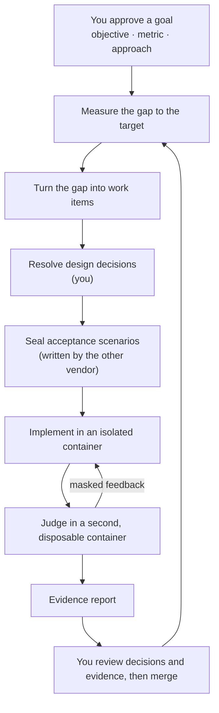

<h1 align="center">oh-my-factory</h1>

<p align="center">
  <strong>A goal-driven software factory for Claude Code and Codex CLI.</strong><br>
  You approve goals, decisions and evidence. Agents do the work inside a sealed, isolated loop.
</p>

<p align="center">
  <a href="LICENSE"></a>
  <a href="https://nodejs.org">= 22.12" src="https://img.shields.io/badge/node-%3E%3D22.12-brightgreen"></a>
  <a href="#what-works-today"></a>
</p>

<p align="center">
  <a href="#quick-start">Quick start</a> ·
  <a href="#how-it-works">How it works</a> ·
  <a href="#what-works-today">What works today</a> ·
  <a href="docs/design/2026-10-12-omf-v0-design.md">Design</a> ·
  <a href="README.ko.md">한국어</a>
</p>

> [!WARNING]
> **Pre-alpha.** Today oh-my-factory ships its foundation (host state, a tamper-evident ledger,
> budgets that never reset), defining, approving and measuring goals (J1 locks, the gap to the
> target, control bands), the J8 budget commands, the work-item store with its `work` and `veto`
> commands, and the goal loop: `omf goal tick` turns the gap into work items with a model that
> never sees the numbers. The verification line that does the work is designed but not built yet.
> See [What works today](#what-works-today).

---

## Why

Coding agents are good at finishing tasks. Finishing tasks is not the same as reaching a goal, and
three things get in the way:

- **Agents grade their own homework.** A test that lives next to the code can be rewritten to match
  the code. A scenario the implementer never sees cannot.
- **Agents lose sight of the goal.** Without a measurement, an agent cannot tell whether the work is
  moving the number or whether a task is missing.
- **People review the wrong thing.** Reading every line does not scale, and rubber-stamping is
  worse. Human judgment should move to the places where it matters: the goal, the design
  decisions, and the evidence.

oh-my-factory (OMF) is a harness for that loop. It drives the stock `claude` and `codex` CLIs; it
does not replace them.

## How it works



OMF runs two loops:

- **The goal loop** keeps the factory pointed at an outcome. It audits the goal, measures the
  current value, compares it with the target and the control bands, reconciles open work, and
  dispatches new work. After launch it keeps watching at a lower frequency and reopens the goal if
  the number regresses.
- **The verification line** handles one work item. A person settles the design decisions. A
  different vendor writes acceptance scenarios that are sealed away from the implementer. The
  implementer works in a devcontainer. A trusted harness judges the result in a separate,
  disposable container and returns only masked feedback. The line ends with an evidence report.

## Where you stay in the loop

| You decide | When |
|---|---|
| The goal: objective, metric, target and guardrails | Before any work |
| Design decisions and interface contracts | Before implementation |
| Which signals to trust, and which paths are high-risk | Before, and when they change |
| Isolation level, security settings and budgets | Before, and on any exception |
| Merge | After the evidence report |
| Goal sign-off | Asynchronously, when the target is met |
| What to do about a stall or an exhausted budget | Asynchronously, when it happens |

Retries, deterministic checks, state transitions and bookkeeping are the factory's job. Risk is
computed from the diff and the paths, never chosen by an agent.

## Design principles

Each principle is either **enforced today** by a test in [`tests/enforcement`](tests/enforcement/README.md),
or **designed** and not built yet.

- **Your configuration is read-only to OMF.** *Enforced today.* OMF reads your repository,
  `AGENTS.md`, `CLAUDE.md`, `~/.claude` and `~/.codex`, and writes only to its own state directory.
- **The ledger is tamper-evident.** *Enforced today.* Every command checks the hash chain first and
  stops if it is broken.
- **Budgets never reset.** *Enforced today.* A restart does not refill a budget, and only a person
  can raise one.
- **Metric code cannot change quietly.** *Enforced today.* A metric is measured only after you approve it,
  an edited lock stops measurement, and a change to the metric's command, to a path it watches (`--watch`), to its
  bands file, or to the goal needs a new approval. Limits are listed under "Define and measure a goal".
- **The model never sees the numbers.** *Enforced today, goal-loop side.* The model that proposes work gets a
  direction and a coarse size bucket, never a value, a threshold, a metric name or a command. Its answer is
  parsed as data and filtered by code before it becomes a work item. The sealed-scenario side is designed.
- **Goals over tasks.** *Partly built.* Work is derived from the gap between a measured value and a
  target. Goals, locks, measurement and the goal loop work today; the verification line that carries
  out a work item is next.
- **Holdout, not homework.** *Designed.* Acceptance scenarios are sealed, written by the other
  vendor, and never shown to the implementer.
- **Isolation is measured, not declared.** *Partly built.* The per-stage measurement types, the stage
  evaluator and GATE-3 exist and are tested without a container, and a run level below the declared one
  stops the line. A level measured on a real container is not enforced yet; `omf doctor` reports it as
  advisory and unmeasured (`docs/isolation-and-gates.md`).
- **Empty means fail.** *Partly built.* The line skeleton (`E7a`), GATE-2 (`E7b`) and the gate line, the
  audit and GATE-3 (`E7c`) read a missing measurement as a failure, never as a pass. The judge's verdict
  file arrives with the container runner.
- **No auto-merge, no auto-deploy.** *Designed.* Candidates live on local `omf/*` branches until a
  person ships them.

## What works today

| Command | What it does |
|---|---|
| `omf init` | Creates host state for the current repository under `~/.omf`. Writes nothing to the repository or to the agent CLIs' configuration. |
| `omf doctor` | Checks git, Docker, Claude Code and Codex, the repository and the ledger, and writes `preflight.json`. Runs the agent CLIs with a throwaway home. |
| `omf ledger verify` | Checks the ledger's hash chain. |
| `omf goal new <id>` | Creates `goal.md` in host state from a template. |
| `omf metric propose <id> --unit <u> -- <command>` | Proposes a metric: the command that prints its value, the unit, and the paths whose change is a regime change. |
| `omf goal audit <id>` | Checks the goal, its locks and the ledger, and reports regime changes. Writes nothing. |
| `omf goal approve <id>` | J1: shows what will be locked (metrics and their bands) and approves it after you type the goal id in a terminal. |
| `omf goal measure <id>` | Runs the locked metrics (in Docker, or on the host with `--runner host`), computes the gap to target and the control bands, and writes a gap report to host state. |
| `omf goal tick <id>` | One pass of the goal loop (spec §4.4): audit, measure, ask a model for work, filter its candidates with code, dispatch work items, check staleness and the loop guards. Needs a reconciler (see "Run the goal loop"). |
| `omf goal status <id>` | Shows the run state (`running`, `blocked_on_user`, `failed`, `finish`, `cancelled`), the open escalation with the commands that unblock it, the rounds left and the open work items. |
| `omf goal resume <id>` | J6 continue: after you fixed what stopped the goal, a typed confirmation in a terminal lets ticks run again. |
| `omf goal cancel <id>` | J6 stop: a typed confirmation in a terminal cancels the goal and every open work item. |
| `omf budget show <id> [--json]` | Prints the rounds, disclosure and wall-time budgets: declared, raised, consumed and remaining. |
| `omf budget declare <id> <kind> <amount>` | J8: declares a `rounds` or `disclosure` budget, in an interactive terminal. |
| `omf budget raise <id> <kind> <amount>` | J8: raises a `rounds`, `disclosure` or `wall_time` cap, in an interactive terminal. Wall time can only be raised, never declared. |
| `omf budget raise <work_id> --rounds <n>` or `--usd <amount>` | J8: raises the round limit or the model spend limit of one work item, in an interactive terminal. The limits are copied from `[w]` in `config.toml` when the item's first run starts. It changes no state: run the item again afterwards. Usable once an item has had a line run (`omf run`, M3h); until then it refuses with exit 2 (no recorded limits). |
| `omf work list <goal-id> [--state <s>] [--json]` | Lists a goal's work items. Items the ledger does not account for are reported as malformed (exit 1). |
| `omf work show <work-id>` | Prints a work item's `item.md`, claim and `intent.md`. |
| `omf work approve <work-id>` | Approves a high-risk work item so it can be dispatched, in an interactive terminal. |
| `omf veto <work-id> [--reason <text>]` | Vetoes a work item from any open state. Needs no terminal, because a veto only restricts. |
| `omf decide add <work-id> --file <entry.json>` | Records a design question of a work item (a decision) in the ledger and rewrites its `spec.md`. Works only while the item is `ready` and no run holds it. |
| `omf decide resolve <work-id> <decision-id> --file <resolution.json> [--na]` | Closes a decision as a person: choice, rationale and rejected options (the interface decision also carries the build, run and gate commands), in an interactive terminal. `--na` marks it not applicable. |
| `omf decide defer <work-id> <decision-id> --file <deferral.json>` | Defers a decision with a signed default and an expiry date, in an interactive terminal. |
| `omf decide lint <work-id> [--json] [--render]` | Checks the decisions and evaluates GATE-1. Exit 0 clean, 1 problems, 3 blocked on a person (J2), which also writes `needs-human.json`. `--render` rewrites `spec.md`. |
| `omf decide show <work-id> [--json]` | Prints the decisions by status, the GATE-1 verdict and whether `spec.md` matches the ledger. Writes nothing. |

Exit codes: `0` ok, `1` needs attention (problems found, a declined confirmation, a tick that stopped or is waiting for your approval), `2` the command could not run, `3` blocked on a person (`omf decide lint`: open design decisions).

Sealed scenarios and GATE-2 exist as library code only, with no command yet. After GATE-1 passes, an author session writes scenarios, OMF stamps them and stores them in a vault outside the repository (`vault/scenarios/<work-id>/<seal-id>/`), and GATE-2 refuses a set that is empty, lacks a split, passes against a program that does nothing, has no contradiction canary (`canary_missing`), or leaves a resolved decision unlinked. Today the author is a stub process on the host, so the author stage is reported as unmeasured and sealing is not enforced. See [`docs/m3c-spec-deviations.md`](docs/m3c-spec-deviations.md).

Not built yet: the container runner and judge, evidence reports, `omf ship`, goal sign-off (`omf goal sign`) and asking people for input in the middle of a run. The
[design](docs/design/2026-10-12-omf-v0-design.md) describes all of them.

## Quick start

Requirements: Node.js 22.12 or later and git. `omf doctor` also looks for Docker, Claude Code and
Codex CLI, which later stages will need.

OMF is not on npm yet. Install it from source:

```sh
git clone https://github.com/ahwlsqja/oh-my-factory.git
cd oh-my-factory
npm install
npm run build
npm link            # puts `omf` on your PATH
```

Then, inside any git repository:

```console
$ omf init
initialized /Users/you/.omf/projects/5a1948fe53d2a09f

$ omf ledger verify
ok: 1 event, head e3796f5ab9e6ec69…

$ omf doctor
problems:
  - docker daemon is not reachable
```

`omf doctor --json` prints the full report.

## Define and measure a goal

```console
$ omf init
initialized ~/.omf/projects/3186047891f1f0a0

$ omf goal new g-demo
created ~/.omf/projects/3186047891f1f0a0/goals/g-demo/goal.md
edit it, propose its metrics with omf metric propose, then run omf goal audit g-demo

$ # edit goal.md: target m-demo <= 5 ms, lagging: [m-demo]
$ omf metric propose m-demo --unit ms -- sh -c 'echo 7'
proposed m-demo as human:you@example.com

$ omf goal audit g-demo
goal g-demo: draft
ready for J1: run omf goal approve g-demo

$ omf goal approve g-demo
goal g-demo: Say what this goal is in a few words
objective: The outcome you want, in plain words
target: m-demo <= 5 ms
leading: none; lagging: m-demo; guardrails: none
budget: 10 rounds, 72h wall time, at most 2 open work items
decision rule: target met for 2 consecutive measurements and no guardrail breach (minimum observation 7d)
metric m-demo: ["sh","-c","echo 7"] -> ms; watches none
bands m-demo: none (not monitored)
Type g-demo to approve as human:you@example.com: g-demo
approved g-demo (regime 1)

$ omf goal measure g-demo --runner host
goal g-demo (regime 1), runner host
target m-demo: 7 ms; target <= 5 ms; gap 2 (decrease, medium)
  m-demo [target, lagging]: 7 ms
report: ~/.omf/projects/3186047891f1f0a0/goals/g-demo/reports/2026-10-12T06-27-24-995Z-gap.json
warning: measured on the host without isolation (--runner host)
```

Re-approval first shows why it is needed: lock problems, the regime changes, and the diff of any changed
watched path. If the goal or a metric changes while you read it, nothing is approved. Re-approval never changes
the budgets: if `goal.md` differs from the rounds or wall time already in force, `omf goal approve` refuses, and
raising either is a separate decision (J8).

Known limits of "metric code cannot change quietly":

- Only the metric's command and the paths you declare with `--watch` are covered. `omf metric propose` warns when
  you give none. Files a metric reads but does not watch, and gitignored inputs, can change without a new approval.
- A container image tag is mutable; pin an image digest to pin the image.
- `bands/<metric>.yaml` is locked with the goal: its hash is part of the J1 approval, so editing, adding or
  deleting one is a regime change. A goal approved before bands were locked keeps unlocked bands until it is
  approved again, and the approval screen says so.

## Run the goal loop

`omf goal tick <id>` is one non-interactive pass of the loop, so cron, CI or a person can run it. A tick audits
the goal, measures the locked metrics and compares them with the target and the control bands. When there is a
reason to act (the target is not met, or a band says `propose`), it asks a model for work item candidates,
filters them with code and writes the survivors as work items in host state. When the target has been met long
enough with every guardrail passing, it records a success candidate and the goal finishes.

The model sees the objective and the `## Approach` section of `goal.md`, the direction of the gap with a size
bucket (`small`, `medium` or `large`), the open work items and outcome counts. It never sees a value, a target, a
threshold, a metric name or command, or a watched path. Its answer is parsed as data. Candidates that carry a
numeric threshold or a metric name, repeat an existing item (in any state), exceed the work-in-progress cap or
point outside the repository are dropped before anything is written.

To see it work offline, run [`examples/hello-goal`](examples/hello-goal/README.md): two turns of the loop with a
stand-in for the model.

### The reconciler

The model is configured in `config.toml`, which OMF never rewrites. A missing file is an error; a missing
`[reconciler]` section means these defaults:

```toml
[reconciler]
kind = "claude"          # or "command": a program that reads the prompt on stdin and prints JSON
# model = "..."
# timeout_ms = 120000
```

`kind = "claude"` runs the `claude` CLI on the host with every tool disabled, no saved session, an empty
temporary directory as its working directory and only `ANTHROPIC_API_KEY` in its environment, so export that
variable before a tick. Keychain and login-file logins are not used. `kind = "command"` runs the argv you list
under `command`; the tests and the example use it. `kind = "codex"` and `auth = "login_file"` are refused until
the container runner exists.

The `claude` kind is unverified against a real model; `scripts/smoke-reconciler.sh` is the manual check. It does
not pass `--json-schema` (Claude Code implements that with an extra tool-call turn, which the one-turn check
rejects); OMF validates the answer against its own schema.

### Rounds, ending states and exit codes

A round is a tick that called the model, and only that tick spends one of the goal's rounds. A tick that waits
(the goal is `observing` or `idle`, the work-in-progress cap is full, too many items await review) spends
nothing; wall time bounds those.

| State | How it happens | What you do |
|---|---|---|
| `running` | the default | nothing |
| `blocked_on_user` | the goal needs a decision: re-approval (J1), a stall or a repeated outcome (J6), a spent round or time budget (J8) | `omf goal status <id>` prints the exact commands; then `omf goal resume <id>` |
| `failed` | an unexpected error inside a tick | read the error, then `omf goal resume <id>` |
| `finish` | a success candidate (spec §4.5) was recorded | sign-off (J5) is not built yet |
| `cancelled` | `omf goal cancel <id>` | final |

`omf goal tick` exits `0` when the tick went on or the goal finished. It exits `1` when it stopped for you
(blocked, failed, or an item is waiting for `omf work approve <work-id>`) and `2` when it could not run (another
tick holds the lock, `config.toml` is missing or invalid, the ledger is corrupt). Its output carries outcomes,
the gap direction and size bucket, work ids, signature codes and next steps, never a measured value or a target:
those stay in the report under host state.

### Work items

Dispatched items live in `goals/<id>/work/<work-id>/`. Risk is classified by code from the paths a candidate
declares. CI, auth, migrations, tests, lockfiles, goal and factory files and your watched paths are high risk: a
high-risk item waits in `awaiting_approval` for `omf work approve`, any other item starts `ready`. You can
`omf veto <work-id>` anything that is open. The ledger, not the item file, decides whether an item was approved,
vetoed or cancelled: an `item.md` edited by hand to look approved is listed by `omf work list` as malformed and
is never dispatched.

Known limits of the goal loop:

- The seed lint catches numbers and metric names, not paraphrase. A model that restates a threshold in other
  words gets through.
- Duplicate detection compares the title words and the declared paths. A reworded title for the same change is a
  new item.
- With no disclosure budget declared, the number of times the model is asked is bounded by the rounds only.
- Subscription and keychain logins are not supported for the reconciler yet; use an API key.
- A re-approval resets the wall-time limit to the value in `goal.md`: raises made earlier with `omf budget raise <id> wall_time` do not carry over, and the approval screen does not show them. After re-approving a stale goal that should keep running, raise the wall time again.

## Where state lives

OMF keeps everything outside your repository, one directory per project:

```
~/.omf/projects/<project-id>/
  ledger.jsonl            append-only, hash-chained event log
  config.toml             roles, isolation level, optional [reconciler]
  preflight.json          the last doctor report
  goals/<goal-id>/
    goal.md               the goal: objective, target, budgets
    bands/<metric>.yaml   control bands (locked with the goal)
    reports/              gap reports (<stamp>-gap.json) and tick reports (<stamp>-tick.md)
    reconcile/            the exact model input and raw output of each tick
    work/<work-id>/       item.md (state and progress) and intent.md
    tick.lock             held while a tick runs
  vault/
    metrics/proposed/     metric proposals, <metric>.json
    metrics/<goal-id>/    J1 locks: <metric>.lock.json, goal.lock.json
    scenarios/            sealed scenario sets: <work-id>/<seal-id>/<scenario-id>.yaml
  runs/  worktrees/       reserved for later stages
```

Set `OMF_HOME` to use another location. OMF refuses to keep state inside the repository or inside
`~/.claude` or `~/.codex`. Directories are `0700` and files `0600`.

Reports and the `reconcile/` files hold real measured values. They stay in host state, and the model never reads them.

To uninstall, run `npm unlink -g oh-my-factory` and delete `~/.omf`.

## Documentation

- [Design specification](docs/design/2026-10-12-omf-v0-design.md) ([한국어](docs/ko/design/2026-10-12-omf-v0-design.md))
- [Sources and reading status](docs/design/references.md)
- [Enforcement tests and the claims they cover](tests/enforcement/README.md)
- [Goal-loop decisions and open questions (M2b addendum)](docs/design/2026-10-12-omf-m2b-addendum.md)
- [`examples/hello-goal`](examples/hello-goal/README.md): the goal loop end to end, offline

## Inspiration

The design builds on Will Larson's software factory experiment, StrongDM's Software Factory,
Anthropic's AI-native SDLC playbook, and the writing of Addy Osmani and Piotr Sarnacki on where
human judgment belongs. The tool layer draws on oh-my-claudecode, oh-my-codex, addyosmani/factory,
Kilroy and OpenAI's Symphony spec; where it adapts a design (the claim lock's staleness checks follow
Kilroy's) the code is independent, and [`docs/third-party.md`](docs/third-party.md) records what is
taken from each. [`docs/design/references.md`](docs/design/references.md) lists every source.

## Contributing

OMF is pre-alpha, so issues and design discussion are the most useful contributions right now.

```sh
npm install
npm run typecheck   # source and tests
npm test            # builds dist/ and runs the suite
```

`sh scripts/smoke-reconciler.sh` runs the real `claude` CLI once with a harmless prompt and checks that the
answer parses. It spends API tokens and needs `ANTHROPIC_API_KEY`, so it is not part of `npm test`.

Commits follow [Conventional Commits](https://www.conventionalcommits.org/).

## License

[Apache-2.0](LICENSE)
