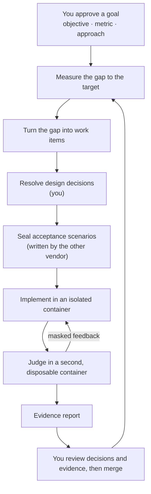

<h1 align="center">oh-my-factory</h1>

<p align="center">
  <strong>A goal-driven software factory for Claude Code and Codex CLI.</strong><br>
  You approve goals, decisions and evidence. Agents do the work inside a sealed, isolated loop.
</p>

<p align="center">
  <a href="LICENSE"></a>
  <a href="https://nodejs.org">= 22.12" src="https://img.shields.io/badge/node-%3E%3D22.12-brightgreen"></a>
  <a href="#what-works-today"></a>
</p>

<p align="center">
  <a href="#quick-start">Quick start</a> ·
  <a href="#how-it-works">How it works</a> ·
  <a href="#what-works-today">What works today</a> ·
  <a href="docs/design/2026-10-12-omf-v0-design.md">Design</a> ·
  <a href="README.ko.md">한국어</a>
</p>

> [!WARNING]
> **Pre-alpha.** Today oh-my-factory ships its foundation (host state, a tamper-evident ledger,
> budgets that never reset), defining, approving and measuring goals (J1 locks, the gap to the
> target, control bands), the J8 budget commands, the work-item store with its `work` and `veto`
> commands, and the goal loop: `omf goal tick` turns the gap into work items with a model that
> never sees the numbers. The verification line runs through three commands: `omf seal` (the sealing author in a container),
> `omf run` and `omf report`. Every test of them runs offline against a fake Docker, so no run has yet shown that a
> real container isolates a real model. Gated container runs are recorded for the `docker inspect` parser, the work
> copy, the two-container round trip and the real isolation probe; no gated run of the author container or of the
> whole line is recorded, and none is recorded for the implementer container or for any suite that calls a model.
> See [What works today](#what-works-today).

---

## Why

Coding agents are good at finishing tasks. Finishing tasks is not the same as reaching a goal, and
three things get in the way:

- **Agents grade their own homework.** A test that lives next to the code can be rewritten to match
  the code. A scenario the implementer never sees cannot.
- **Agents lose sight of the goal.** Without a measurement, an agent cannot tell whether the work is
  moving the number or whether a task is missing.
- **People review the wrong thing.** Reading every line does not scale, and rubber-stamping is
  worse. Human judgment should move to the places where it matters: the goal, the design
  decisions, and the evidence.

oh-my-factory (OMF) is a harness for that loop. It drives the stock `claude` and `codex` CLIs; it
does not replace them.

## How it works



OMF runs two loops:

- **The goal loop** keeps the factory pointed at an outcome. It audits the goal, measures the
  current value, compares it with the target and the control bands, reconciles open work, and
  dispatches new work. After launch it keeps watching at a lower frequency and reopens the goal if
  the number regresses.
- **The verification line** handles one work item. A person settles the design decisions. A
  different vendor writes acceptance scenarios that are sealed away from the implementer. The
  implementer works in a devcontainer. A trusted harness judges the result in a separate,
  disposable container and returns only masked feedback. The line ends with an evidence report.

## Where you stay in the loop

| You decide | When |
|---|---|
| The goal: objective, metric, target and guardrails | Before any work |
| Design decisions and interface contracts | Before implementation |
| Which signals to trust, and which paths are high-risk | Before, and when they change |
| Isolation level, security settings and budgets | Before, and on any exception |
| Merge | After the evidence report |
| Goal sign-off | Asynchronously, when the target is met |
| What to do about a stall or an exhausted budget | Asynchronously, when it happens |

Retries, deterministic checks, state transitions and bookkeeping are the factory's job. Risk is
computed from the diff and the paths, never chosen by an agent.

## Design principles

Each principle is either **enforced today** by a test in [`tests/enforcement`](tests/enforcement/README.md),
or **designed** and not built yet.

- **Your configuration is read-only to OMF.** *Enforced today.* OMF reads your repository,
  `AGENTS.md`, `CLAUDE.md`, `~/.claude` and `~/.codex`, and writes only to its own state directory.
- **The ledger is tamper-evident.** *Enforced today.* Every command checks the hash chain first and
  stops if it is broken.
- **Budgets never reset.** *Enforced today.* A restart does not refill a budget, and only a person
  can raise one.
- **Metric code cannot change quietly.** *Enforced today.* A metric is measured only after you approve it,
  an edited lock stops measurement, and a change to the metric's command, to a path it watches (`--watch`), to its
  bands file, or to the goal needs a new approval. Limits are listed under "Define and measure a goal".
- **The model never sees the numbers.** *Enforced today, goal-loop side.* The model that proposes work gets a
  direction and a coarse size bucket, never a value, a threshold, a metric name or a command. Its answer is
  parsed as data and filtered by code before it becomes a work item. The sealed-scenario side is designed.
- **Goals over tasks.** *Partly built.* Work is derived from the gap between a measured value and a
  target. Goals, locks, measurement and the goal loop work today; the verification line that carries
  out a work item is next.
- **Holdout, not homework.** *Designed.* Acceptance scenarios are sealed, written by the other
  vendor, and never shown to the implementer.
- **Isolation is measured, not declared.** *Partly built.* The judge runs a candidate in two disposable containers (a
  system under test and a harness; no network, no `docker.sock`, no mounted path; the harness holds the scenarios,
  loaded over stdin, and the SUT never sees an expectation) and measures each with
  `docker inspect` before candidate code runs in it. GATE-3 reads those measurements from the ledger. Only the offline
  form against a fake Docker is tested, and what a real container does is not enforced beyond the gated runs recorded in
  `docs/evidence/gated-runs.json` (the real isolation probe and the two-container round trip); the implementer container has no recorded run. The implementer container is run by `omf run`, offline against a fake Docker only
  ([`docs/implementer.md`](docs/implementer.md)) and the author container is started only by `omf seal`, which has not been run against a real daemon or model, so a real line still stops at GATE-3 as `isolation_unmeasured` until the gated author runs are recorded ([`docs/container-judge.md`](docs/container-judge.md)).
- **Empty means fail.** *Partly built.* The line skeleton (`E7a`), GATE-2 (`E7b`) and the gate line, the
  audit and GATE-3 (`E7c`) read a missing measurement as a failure, never as a pass. The judge's verdict
  (`E7d`) is the same: a missing, malformed or foreign verdict ends the round and is never a pass.
- **No auto-merge, no auto-deploy.** *Designed.* Candidates live on local `omf/*` branches until a
  person ships them.

## What works today

| Command | What it does |
|---|---|
| `omf init` | Creates host state for the current repository under `~/.omf`. Writes nothing to the repository or to the agent CLIs' configuration. |
| `omf ui [--port <port>] [--no-open]` | Opens an optional, local read-only operations dashboard. Shows verified snapshot state, goal IDs, disclosed gap buckets, work, human-attention codes, recorded evidence recommendations and recent events. No approvals or execution. Port `0` (the default) chooses an available loopback port; `--no-open` prints the session URL. See [the UI guide](docs/ui.md). |
| `omf doctor [--json] [--strict]` | Checks git, Docker, Claude Code and Codex, the repository and the ledger, and writes `preflight.json`. Runs the agent CLIs with a throwaway home. A missing or unreachable Docker, or a missing agent CLI, is a warning that names the stage that needs it; every problem and warning has a one-line fix. `--strict` turns the missing-tool warnings into problems; a torn ledger tail stays a warning. It also reports an advisory isolation probe (a throwaway container) when `[judge]` names an image and a Docker context, otherwise `unmeasurable` with the reason. The JSON report also carries an advisory `implementer` row: whether an implementer image is configured and whether `OMF_IMPLEMENTER_API_KEY` is set, by name only, never the value. |
| `omf ledger verify [--json]` | Checks the ledger's hash chain. On a corrupt ledger, stderr line 2 gives the path, the line and the next step; `--json` gives the same as fields. With `--json` every error is `{ "ok": false, "error": { "code": "...", "message": "..." } }` (codes: `not_initialized`, `ledger_corrupt`, `not_a_git_repository`, `git_not_found`, `unsupported_repository`, `symlink_refused`, `cannot_run`); keys are snake_case. Exit 2 before `omf init`. |
| `omf goal new <id>` | Creates `goal.md` in host state from a template. |
| `omf metric propose <id> --unit <u> -- <command>` | Proposes a metric: the command that prints its value, the unit, and the paths whose change is a regime change. |
| `omf goal audit <id>` | Checks the goal, its locks and the ledger, reports regime changes, and lists template text you have not replaced yet (`placeholders` in `--json`). Writes nothing. |
| `omf goal approve <id>` | J1: shows what will be locked (metrics and their bands) and approves it after you type the goal id in a terminal. |
| `omf goal measure <id>` | Runs the locked metrics (in Docker, or on the host with `--runner host`), computes the gap to target and the control bands, and writes a gap report to host state. |
| `omf goal tick <id>` | One pass of the goal loop (spec §4.4): audit, measure, ask a model for work, filter its candidates with code, dispatch work items, check staleness and the loop guards. Needs a reconciler (see "Run the goal loop"). |
| `omf goal status <id>` | Shows the run state (`running`, `blocked_on_user`, `failed`, `finish`, `cancelled`; a goal that is still a draft or needs re-approval says so instead of `running`, and an approved goal with no tick yet says that), the open escalation with the commands that unblock it, the rounds left and the open work items. |
| `omf goal resume <id>` | J6 continue: after you fixed what stopped the goal, a typed confirmation in a terminal lets ticks run again. |
| `omf goal cancel <id>` | J6 stop: a typed confirmation in a terminal cancels the goal and every open work item. |
| `omf budget show <id> [--json]` | Prints the rounds, disclosure and wall-time budgets: declared, raised, consumed and remaining. |
| `omf budget declare <id> <kind> <amount>` | J8: declares a `rounds` or `disclosure` budget, in an interactive terminal. |
| `omf budget raise <id> <kind> <amount>` | J8: raises a `rounds`, `disclosure` or `wall_time` cap, in an interactive terminal. Wall time can only be raised, never declared. |
| `omf budget raise <work_id> --rounds <n>` or `--usd <amount>` | J8: raises the round limit or the model spend limit of one work item, in an interactive terminal. The limits are copied from `[w]` in `config.toml` when the item's first run starts. It changes no state: run the item again afterwards. Usable once an item has had a line run (`omf run`, M3h); until then it refuses with exit 2 (no recorded limits). |
| `omf work list <goal-id> [--state <s>] [--json]` | Lists a goal's work items. Items the ledger does not account for are reported as malformed (exit 1). |
| `omf work show <work-id>` | Prints a work item's `item.md`, claim and `intent.md`. |
| `omf work approve <work-id>` | Approves a high-risk work item so it can be dispatched, in an interactive terminal. |
| `omf veto <work-id> [--reason <text>]` | Vetoes a work item from any open state. Needs no terminal, because a veto only restricts. |
| `omf decide add <work-id> --file <entry.json>` | Records a design question of a work item (a decision) in the ledger and rewrites its `spec.md`. Works only while the item is `ready` and no run holds it. |
| `omf decide resolve <work-id> <decision-id> --file <resolution.json> [--na]` | Closes a decision as a person: choice, rationale and rejected options (the interface decision also carries the build, run and gate commands), in an interactive terminal. `--na` marks it not applicable. |
| `omf decide defer <work-id> <decision-id> --file <deferral.json>` | Defers a decision with a signed default and an expiry date, in an interactive terminal. |
| `omf decide lint <work-id> [--json] [--render]` | Checks the decisions and evaluates GATE-1. Exit 0 clean, 1 problems, 3 blocked on a person (J2), which also writes `needs-human.json`. `--render` rewrites `spec.md`. |
| `omf decide show <work-id> [--json]` | Prints the decisions by status, the GATE-1 verdict and whether `spec.md` matches the ledger. Writes nothing. |
| `omf seal <work-id> [--json]` | Runs the sealing author (Codex) for a work item in a container whose isolation OMF measures first. The author gets the item's intent, spec and interface contract and nothing else. The scenarios go to the vault and GATE-2 is evaluated. Needs `[judge] docker_context`, `[author] image` and, for that one command, `OMF_AUTHOR_API_KEY` (see `docs/author.md`). Idempotent: a seal that is current for the decisions, with a measured author stage, exits 0 as `already_sealed` without a key or a model call. Exit 0 sealed or already sealed (the author stage is measured), 1 stored with the author stage unmeasured, the author's answer failed or GATE-2 sent it back, 2 refused, could not run or stopped for the environment (J7), 3 blocked on a person. The author container and the judge containers have not yet been run against a real daemon or model, and this is not enforced until the gated author suites are recorded (see [`docs/author.md`](docs/author.md)). |
| `omf run <work-id> [--json]` | Runs the verification line for a work item that has a current seal: implement in a container, judge in two disposable containers, audit, spend the test split once, write the evidence. Refuses out of order and names the missing gate (GATE-1: `omf decide lint`, GATE-2: `omf seal`). Exit 0 success, 1 flawed, 2 aborted, refused or stopped for the environment (J7), 3 blocked on a person. An item that already ran prints `already ran` and exits 0. The author container and the judge containers have not yet been run against a real daemon or model, and this is not enforced until the gated author suites are recorded (see [`docs/author.md`](docs/author.md)). |
| `omf report <work-id> [--json]` | Prints the evidence of a finished run, rendered again from the validated `evidence.json` (the bytes of `evidence.md` are never printed), with the judge line (deterministic checks only) and the run's isolation level. Read-only. Exit 0 trusted evidence shown, 2 none or untrusted (run `omf run` first). |

Exit codes: `0` ok, `1` needs attention (problems found, a declined confirmation, a tick that stopped or is waiting for your approval), `2` the command could not run, `3` blocked on a person (`omf decide lint`: open design decisions).

Sealed scenarios and GATE-2 run through `omf seal`, which has not been run against a real daemon or model. After GATE-1 passes, an author session writes scenarios, OMF stamps them and stores them in a vault outside the repository (`vault/scenarios/<work-id>/<seal-id>/`), and GATE-2 refuses a set that is empty, lacks a split, passes against a program that does nothing, has no contradiction canary (`canary_missing`), or leaves a resolved decision unlinked. `omf seal` runs the author in a measured container; that is not enforced until the `G-author-*` gated runs are recorded. See [`docs/m3c-spec-deviations.md`](docs/m3c-spec-deviations.md).

The judge stations run inside `omf run`. S4 judges the stored train split and the contradiction canaries in two disposable containers, k times; S5 runs the gates and prove-test in a container work copy and audits; S6 spends the test split once. Everything is tested offline against a fake Docker, and a real-container run is gated and not enforced until it is recorded. See [`docs/container-judge.md`](docs/container-judge.md).

Not built yet: `omf ship`, goal sign-off (`omf goal sign`) and asking people for input in the middle of a run. The
[design](docs/design/2026-10-12-omf-v0-design.md) describes all of them.

## Quick start

Requirements: Node.js 22.12 or later and git. `omf doctor` also looks for Docker, Claude Code and
Codex CLI, which later stages will need.

OMF is not on npm yet. Install it from source:

```sh
git clone https://github.com/ahwlsqja/oh-my-factory.git
cd oh-my-factory
npm install
npm run build
npm link            # puts `omf` on your PATH
```

Then, inside any git repository:

```console
$ omf init
initialized /Users/you/.omf/projects/5a1948fe53d2a09f

$ omf ledger verify
ok: 1 event, head e3796f5ab9e6ec69…

$ omf doctor
ok
warning: claude not found on PATH (needed for: the implementer, the sealing author)
  fix: install the claude CLI and make sure `claude` is on PATH
```

`omf doctor` exits 1 only for problems (for example `project not initialized; run omf init`, each with a `fix:` line).
Warnings do not change the exit code, so a machine without a running Docker still exits 0; `omf doctor --strict` counts the missing-tool warnings (no Docker binary, Docker not running, no agent CLI) as problems (a torn ledger tail stays a warning). `omf doctor --json` prints the full
report, including `problem_details` and `warning_details` with the fix and the stages that need a tool.

## Define and measure a goal

Commands that record a person's decision (`omf metric propose`, `omf goal approve`, `omf goal resume`,
`omf goal cancel`, `omf work approve`, `omf work veto`, `omf budget declare`, `omf budget raise`, `omf decide resolve` and `omf decide defer`) identify you as
`human:<email>`, where the email is what `git config user.email` returns inside the repository. Set it first, or
the command stops and says so. The identifier is printed in the command output, including the confirmation
prompt, and is stored in the project's `ledger.jsonl`, in the proposal and lock files, and in a work item's `item.md`
(its `approval` field) under `~/.omf` (or `OMF_HOME`), all on your machine. OMF never sends it anywhere: there is no telemetry and nothing is published.
Before you paste output, a ledger excerpt or a report into an issue or a chat, redact the address, for example by
replacing it with `human:you@example.com`. It is not a secret, but it is personal data. See
[`SECURITY.md`](SECURITY.md) for what else to leave out.

```console
$ omf init
initialized ~/.omf/projects/3186047891f1f0a0

$ omf goal new g-demo
created ~/.omf/projects/3186047891f1f0a0/goals/g-demo/goal.md
edit it (the comments in the file explain each field), propose its metrics with omf metric propose, then run omf goal audit g-demo

$ # edit goal.md: target m-demo <= 5 ms, lagging: [m-demo]
$ omf metric propose m-demo --unit ms -- sh -c 'echo 7'
proposed m-demo as human:you@example.com

$ omf goal audit g-demo
goal g-demo: draft
ready for J1: run omf goal approve g-demo

$ omf goal approve g-demo
goal g-demo: Say what this goal is in a few words
objective: The outcome you want, in plain words
target: m-demo <= 5 ms
leading: none; lagging: m-demo; guardrails: none
budget: 10 rounds, 14d wall time, at most 2 open work items
decision rule: target met for 2 consecutive measurements and no guardrail breach (minimum observation 7d)
metric m-demo: ["sh","-c","echo 7"] -> ms; watches none
bands m-demo: none (not monitored)
Type g-demo to approve as human:you@example.com: g-demo
approved g-demo (regime 1)

$ omf goal measure g-demo --runner host
goal g-demo (regime 1), runner host
target m-demo: 7 ms; target <= 5 ms; gap 2 (decrease, medium)
  m-demo [target, lagging]: 7 ms
measured at revision 4f1c9a0e7b2d (clean), observed 2026-10-12T06:27:24.995Z
working directory: repository root (host, no isolation)
fingerprint: 9be03c51a7d2 (recorded in the ledger as input_sha256)
limit: The tree was observed once, before the first metric ran; it was not watched while the metrics ran.
limit: The fingerprint covers HEAD and the list of changed paths, not file contents: an edit to a file that was already modified keeps the same fingerprint.
limit: An edit made while a metric runs can change its value without changing this record.
limit: Gitignored files are not part of the observation.
report: ~/.omf/projects/3186047891f1f0a0/goals/g-demo/reports/2026-10-12T06-27-24-995Z-gap.json
warning: measured on the host without isolation (--runner host)
```

The provenance lines (also stored in the gap report as `provenance`) say which commit was measured, whether
the tree was clean or dirty with a count of changed paths, and where the metric ran: the repository root on the
host, or `/work`, a read-only mount of it, in Docker. They are host-only, like the rest of the report. The
fingerprint is the `input_sha256` the ledger already records, taken once before the first metric ran. It does not
prove that files stayed unchanged while the metrics ran, and it cannot tell two edits of an already modified file
apart, so a value measured while you or an agent edit the checkout may not match the revision shown.

The generated `goal.md` explains each field in `#` notes inside the front matter. Under `## Approach` it has three
subsections to fill in: `### Why`, `### Constraints` and `### Done when`. That section and `objective` are the only
text a model sees (see "Run the goal loop"), so write them in words, without numbers or metric ids.
`omf goal audit` also lists any template text you have not replaced yet (for example the placeholder metric id
`m-replace-me`); this list is advice and does not change the audit result.
The same list is the `placeholders` field of `omf goal audit --json`.
In the template, `#` notes also mark which values are OMF defaults you may keep (the budget) and which are your decisions (the target value and operator, `min_observation`, `decision_rule`).

Re-approval first shows why it is needed: lock problems, the regime changes, and the diff of any changed
watched path. If the goal or a metric changes while you read it, nothing is approved. Re-approval never changes
the budgets: if `goal.md` differs from the rounds or wall time already in force, `omf goal approve` refuses, and
raising either is a separate decision (J8).

Wall time is calendar time from the first approval, and success needs readings that span the minimum observation,
so the generated `goal.md` pairs a 7d minimum observation with a 14d wall time. If you set a wall time that is not
longer than the minimum observation, `omf goal audit` and the approval screen warn that the goal cannot reach
success before the budget ends. It is a warning, not a refusal: approve anyway, then when the budget runs out raise
it with `omf budget raise <id> wall_time <duration>` and continue with `omf goal resume <id>`. Nothing raises the
budget or resets elapsed time for you.

Known limits of "metric code cannot change quietly":

- Only the metric's command and the paths you declare with `--watch` are covered. `omf metric propose` warns when
  you give none. Files a metric reads but does not watch, and gitignored inputs, can change without a new approval.
- A container image tag is mutable, so a metric image must be pinned by digest (`name@sha256:<64 hex digits>`):
  `omf metric propose --image` refuses a tag, and so does approving a goal whose stored proposal holds one. A metric
  locked with a tag before this rule keeps measuring, and every `omf goal measure` and `omf goal tick` run with
  `--runner docker` (the default) prints a warning for it; propose the metric again with a digest to pin it.
- `bands/<metric>.yaml` is locked with the goal: its hash is part of the J1 approval, so editing, adding or
  deleting one is a regime change. A goal approved before bands were locked keeps unlocked bands until it is
  approved again, and the approval screen says so.

## Measure without Docker

A metric is any command that prints a number. You do not need Docker to define, approve and measure one: approve
the goal in a terminal as usual and measure with `--runner host`. This walkthrough uses a throwaway repository and
Biome (the linter this project uses) as the tool being measured. Replace the tool and the number with your own
once it works.

**What the host runner is.** The command runs in the repository root, on the working tree as it is right now
(uncommitted edits included), with only `PATH`, a throwaway `HOME` and the C locale in its environment. There is
no isolation: it can read and write anything your user can, and nothing stops it from changing the repository.
`omf goal measure --runner host` says so on stderr every time. Use it for commands you wrote or reviewed. If
another process edits files while it runs, the value moves with them.

**The contract.** The metric command must print its value as the last non-empty line of stdout, as a plain
number (`3`, `0.25`, `-1`, `1e3`). Anything printed before that line is ignored, so a script can print a human
summary first. The measurement fails, with a reason, and records no value when the command prints nothing, the
last line is not a number, the command exits non-zero, runs longer than two minutes, or prints more than 1 MiB.
`omf goal measure` then exits 1, so a script that cannot read its tool must exit non-zero rather than print a
guess. The script below follows that rule for Biome itself: if Biome exits non-zero (for example because a file
has a lint error), the script exits 1 and reports no value, even though Biome still prints a summary. Fix the
errors first; a warnings count taken next to errors would be a number nobody asked for.

**Choose the quantity first.** Biome counts warnings and infos separately, and the plain `biome lint` output
ends with a line for each (`Found N warnings.` and `Found N infos.`). Those are different quantities, and the
goal should name one. The script below counts warnings and ignores infos; to track infos instead, read
`summary.infos` and change the metric id and unit to match. Reading the JSON summary also avoids parsing text
meant for people.

The fixture, in a new directory. Every file is a plain block you can copy.

```json biome.json
{
  "linter": {
    "rules": {
      "style": { "useConst": "info" },
      "suspicious": { "noVar": "warn" }
    }
  }
}
```

```js src/app.js
var a = 1;
var c = 3;
var d = 4;
let b = 2;
console.log(a, b, c, d);
```

```js scripts/count-biome-warnings.mjs
import { spawnSync } from "node:child_process";

const run = spawnSync(
  "npx",
  ["--no-install", "biome", "lint", "--max-diagnostics=none", "--reporter=json", "."],
  { encoding: "utf8" },
);
if (run.error) {
  console.error(`could not run biome: ${run.error.message}`);
  process.exit(1);
}
if (run.status !== 0) {
  console.error(`biome exited with ${run.status}; fix its errors first, no value is reported`);
  process.exit(1);
}
let summary;
try {
  summary = JSON.parse(run.stdout).summary;
} catch {
  console.error("biome did not print a JSON summary");
  process.exit(1);
}
if (!Number.isInteger(summary?.warnings) || !Number.isInteger(summary?.infos)) {
  console.error("the biome summary has no warning and info counts");
  process.exit(1);
}
console.log(`warnings: ${summary.warnings} (measured), infos: ${summary.infos} (ignored)`);
console.log(summary.warnings);
```

Set it up (`git init`, add Biome with `npm install --save-dev --save-exact @biomejs/biome@2.5.15`, then create the three files) and
check the script before OMF sees it. `npx biome lint .` should report 3 warnings and 1 info, and the script
should end with `3`. Commit the files too: J1 approval refuses to lock a metric while a path it watches has
uncommitted changes.

```console
$ node scripts/count-biome-warnings.mjs
warnings: 3 (measured), infos: 1 (ignored)
3
```

Now define the goal. `omf goal new g-biome-zero` writes `goal.md`; in it set the target to
`metric_id: m-biome-warnings`, `operator: "<="`, `value: 0`, `unit: warnings`, and `lagging: [m-biome-warnings]`.
The metric id, the unit and the target unit must be the same strings in every command below.

```console
$ omf init
$ omf goal new g-biome-zero
$ omf metric propose m-biome-warnings --unit warnings --watch scripts/count-biome-warnings.mjs --watch biome.json -- node scripts/count-biome-warnings.mjs
$ omf goal audit g-biome-zero
$ git add biome.json scripts src
$ git -c user.email=dev@example.com -c user.name=Dev commit -m "Add the Biome fixture"
$ omf goal approve g-biome-zero
$ omf goal measure g-biome-zero --runner host
```

`omf goal approve` needs a terminal and you type the goal id yourself; nothing here approves for you. The
measurement should read `target m-biome-warnings: 3 warnings; target <= 0 warnings; gap 3 (decrease, large)`, the same number the
script printed.

**Choose what to watch.** `--watch` is repeatable and names the files whose change must be a regime change: here
the script, which defines how the number is computed, and `biome.json`, which decides what counts as a warning.
A watch covers a whole file, not a part of it. If you also watch `package.json` to catch a Biome upgrade, its
`version` field is watched too, so a release that only bumps the version changes the watched file, and the goal
correctly needs re-approval (J1) before the next measurement. That is the check working, not a bug. Keep the
watches to the files that define the metric, and do not drop a watch to avoid re-approving: the unwatched change
could then alter the number without anyone approving it. If a tool upgrade should count, watch the lockfile, or
let the script read and print the tool version, and accept re-approval when it changes.

## Run the goal loop

`omf goal tick <id>` is one non-interactive pass of the loop, so cron, CI or a person can run it. A tick audits
the goal, measures the locked metrics and compares them with the target and the control bands. When there is a
reason to act (the target is not met, or a band says `propose`), it asks a model for work item candidates,
filters them with code and writes the survivors as work items in host state. When the target has been met long
enough with every guardrail passing, it records a success candidate and the goal finishes.

The model sees the objective and the `## Approach` section of `goal.md`, the direction of the gap with a size
bucket (`small`, `medium` or `large`), the open work items and outcome counts. It never sees a value, a target, a
threshold, a metric name or command, or a watched path. Its answer is parsed as data. Candidates that carry a
numeric threshold or a metric name, repeat an existing item (in any state), exceed the work-in-progress cap or
point outside the repository are dropped before anything is written.

To see it work offline, run [`examples/hello-goal`](examples/hello-goal/README.md): two turns of the loop with a
stand-in for the model.

### The reconciler

The model is configured in `config.toml`, which OMF never rewrites. A missing file is an error; a missing
`[reconciler]` section means these defaults:

```toml
[reconciler]
kind = "claude"          # or "command": a program that reads the prompt on stdin and prints JSON
# model = "..."
# timeout_ms = 120000
```

`kind = "claude"` runs the `claude` CLI on the host with every tool disabled, no saved session, an empty
temporary directory as its working directory and only `ANTHROPIC_API_KEY` in its environment, so export that
variable before a tick. Keychain and login-file logins are not used. `kind = "command"` runs the argv you list
under `command`; the tests and the example use it. `kind = "codex"` and `auth = "login_file"` are refused: they
need a credential decision that is not made yet.

The `claude` kind is unverified against a real model; `scripts/smoke-reconciler.sh` is the manual check. It does
not pass `--json-schema` (Claude Code implements that with an extra tool-call turn, which the one-turn check
rejects); OMF validates the answer against its own schema.

The implementer container is different on purpose. Code the implementer writes and runs inside its container can
read the key it is given, so the key is never the reconciler's `ANTHROPIC_API_KEY`. Create a separate Anthropic
workspace key with a spend limit and export it as `OMF_IMPLEMENTER_API_KEY` for the one command that runs the
implementer. OMF reads that variable only (it does not fall back to `ANTHROPIC_API_KEY`) and hands the key to the
container under the name the Claude CLI expects. If it is missing, the implementer step is blocked as an
infrastructure failure (`infra_failure`, so a rerun with the key set can succeed). The stop carries only that code; the advisory `implementer` row of `omf doctor --json` names `OMF_IMPLEMENTER_API_KEY` and whether it is set.

### Rounds, ending states and exit codes

A round is a tick that called the model, and only that tick spends one of the goal's rounds. A tick that waits
(the goal is `observing` or `idle`, the work-in-progress cap is full, too many items await review) spends
nothing; wall time bounds those.

| State | How it happens | What you do |
|---|---|---|
| `running` | the default | nothing |
| `blocked_on_user` | the goal needs a decision: re-approval (J1), a stall or a repeated outcome (J6), a spent round or time budget (J8) | `omf goal status <id>` prints the exact commands; then `omf goal resume <id>` |
| `failed` | an unexpected error inside a tick | read the error, then `omf goal resume <id>` |
| `finish` | a success candidate (spec §4.5) was recorded | sign-off (J5) is not built yet |
| `cancelled` | `omf goal cancel <id>` | final |

`omf goal tick` exits `0` when the tick went on or the goal finished. It exits `1` when it stopped for you
(blocked, failed, or an item is waiting for `omf work approve <work-id>`) and `2` when it could not run (another
tick holds the lock, `config.toml` is missing or invalid, the ledger is corrupt). Its output carries outcomes,
the gap direction and size bucket, work ids, signature codes and next steps, never a measured value or a target:
those stay in the report under host state.

### Work items

Dispatched items live in `goals/<id>/work/<work-id>/`. Risk is classified by code from the paths a candidate
declares. CI, auth, migrations, lockfiles, goal and factory files and your watched paths are high risk. A test file is not
high risk by itself, neither when a candidate declares it nor when the audit reads the real diff. A declared test path has
no diff yet, so it does not make an item high at dispatch. After the implementation the audit runs a deterministic
test-weakening check on the diff and raises the item to high only for a change that weakens tests: a deleted test file,
a test that loses more assertion lines than it gains, an added skip, only, todo, fixme, expected-failure or x- or f-prefixed marker (`xit`, `xdescribe`, `fit` and the like),
a hook that changes how other tests run (a `conftest.py` at any depth, a Go `TestMain` or `func init()`, `this.skip()`, a process exit such as `os.Exit`, `sys.exit`, `process.exit` or `pytest.exit`), a lowered or removed threshold
(every `key: number` pair of the code part of a line is compared, so a commented-out threshold counts as removed, and a line it cannot pair counts as weakening), a new or edited test
runner or coverage config under a test path (unless it only raises threshold numbers and leaves the rest of every changed line exactly as it was; `.coveragerc`, `codecov.yml` and `package.json` under a test path are held to the same rule), or a binary section (one byte such as a NUL makes a section binary) on a test path or a coverage or runner config, which cannot be read and so counts as weakening. A mode-only change stays normal. A runner or coverage config outside a test
path gets the numeric-threshold check, including conservative handling of ambiguous threshold lines. A test change that does not weaken tests no longer adds the high-risk-paths
review area to the evidence, which it used to. When
the check cannot run, for example the diff cannot be read in full, every test change stays high. Risk only rises between
declaration and audit. The check reads changed lines and is not a proof; its known limits are listed below. A high-risk item waits in `awaiting_approval` for `omf work approve`, any other item starts `ready`. You can
`omf veto <work-id>` anything that is open. The ledger, not the item file, decides whether an item was approved,
vetoed or cancelled: an `item.md` edited by hand to look approved is listed by `omf work list` as malformed and
is never dispatched.

Quoted `#` and `//` markers remain part of the code; genuine trailing comments are ignored. A threshold-bearing line with an ambiguous comment boundary, such as an unquoted slash that could start a regular expression or an unfinished quote, is handled conservatively as weakening. Ambiguous lines cannot receive the threshold-only configuration exception; this can flag benign edits.

Known limits of the goal loop:

- The test-weakening check is line based. It does not follow a block comment that spans lines, an early `return` or
  `if (false)` that stops a test from running, a weaker matcher (`toBeTruthy` for `toBe(1)`), an assertion replaced by
  one that is always true, edits to snapshots or fixtures, or an `include` or `exclude` that narrows which tests run.
  What a binary section changes is not inspected: it is flagged as unreadable, never judged. The check counts removed and added assertion lines, so a rewrite that keeps the count
  looks unchanged. A raised tolerance (a codecov `threshold`, a screenshot threshold) is not detected.

- The seed lint catches numbers and metric names, not paraphrase. A model that restates a threshold in other
  words gets through.
- Duplicate detection compares the title words and the declared paths. A reworded title for the same change is a
  new item.
- With no disclosure budget declared, the number of times the model is asked is bounded by the rounds only. Masked feedback to the implementer is released by S6 to the next S3 round inside `omf run`, and is never released until a `disclosure` budget is declared.
- A declared `disclosure` budget is one pool per goal. Goal re-seeds draw from it today; masked-feedback releases draw from the same pool, so either can use it up and block the other. Only a person raises it (`omf budget raise <id> disclosure <amount>`).
- Subscription and keychain logins are not supported for the reconciler yet; use an API key.
- A re-approval resets the wall-time limit to the value in `goal.md`: raises made earlier with `omf budget raise <id> wall_time` do not carry over, and the approval screen does not show them. After re-approving a stale goal that should keep running, raise the wall time again.

## Where state lives

OMF keeps everything outside your repository, one directory per project:

```
~/.omf/projects/<project-id>/
  ledger.jsonl            append-only, hash-chained event log
  config.toml             roles, isolation level, optional [reconciler]
  preflight.json          the last doctor report
  goals/<goal-id>/
    goal.md               the goal: objective, target, budgets
    bands/<metric>.yaml   control bands (locked with the goal)
    reports/              gap reports (<stamp>-gap.json) and tick reports (<stamp>-tick.md)
    reconcile/            the exact model input and raw output of each tick
    work/<work-id>/       item.md (state, progress and the approval, with the approver) and intent.md
    tick.lock             held while a tick runs
  vault/
    metrics/proposed/     metric proposals, <metric>.json
    metrics/<goal-id>/    J1 locks: <metric>.lock.json, goal.lock.json
    scenarios/            sealed scenario sets: <work-id>/<seal-id>/<scenario-id>.yaml
  runs/  worktrees/       reserved for later stages
```

Set `OMF_HOME` to use another location. OMF refuses to keep state inside the repository or inside
`~/.claude` or `~/.codex`. Directories are `0700` and files `0600`.

The ledger, the metric proposals and the J1 locks also hold the `human:<email>` of whoever proposed or approved
(see "Define and measure a goal"); redact it before sharing any of them.

Reports and the `reconcile/` files hold real measured values. They stay in host state, and the model never reads them.

To uninstall, run `npm unlink -g oh-my-factory` and delete `~/.omf`.

## Documentation

- [Design specification](docs/design/2026-10-12-omf-v0-design.md) ([한국어](docs/ko/design/2026-10-12-omf-v0-design.md))
- [Sources and reading status](docs/design/references.md)
- [Enforcement tests and the claims they cover](tests/enforcement/README.md)
- [Command usage](docs/cli-usage.md): the exact `--help` text of every command, checked against the built CLI
- [The sealing author container](docs/author.md): the author's image, key, boundary and limits
- [Conformance matrix](docs/conformance-matrix.md): every requirement as covered, unproven or missing
- [Goal-loop decisions and open questions (M2b addendum)](docs/design/2026-10-12-omf-m2b-addendum.md)
- [`examples/hello-goal`](examples/hello-goal/README.md): the goal loop end to end, offline

## Inspiration

The design builds on Will Larson's software factory experiment, StrongDM's Software Factory,
Anthropic's AI-native SDLC playbook, and the writing of Addy Osmani and Piotr Sarnacki on where
human judgment belongs. The tool layer draws on oh-my-claudecode, oh-my-codex, addyosmani/factory,
Kilroy and OpenAI's Symphony spec; where it adapts a design (the claim lock's staleness checks follow
Kilroy's) the code is independent, and [`docs/third-party.md`](docs/third-party.md) records what is
taken from each. [`docs/design/references.md`](docs/design/references.md) lists every source.

## Contributing

OMF is pre-alpha, so issues and design discussion are the most useful contributions right now.

```sh
npm install
npm run typecheck   # source and tests
npm test            # builds dist/ and runs the suite
```

`sh scripts/smoke-reconciler.sh` runs the real `claude` CLI once with a harmless prompt and checks that the
answer parses. It spends API tokens and needs `ANTHROPIC_API_KEY`, so it is not part of `npm test`.

Commits follow [Conventional Commits](https://www.conventionalcommits.org/).

## License

[Apache-2.0](LICENSE)
